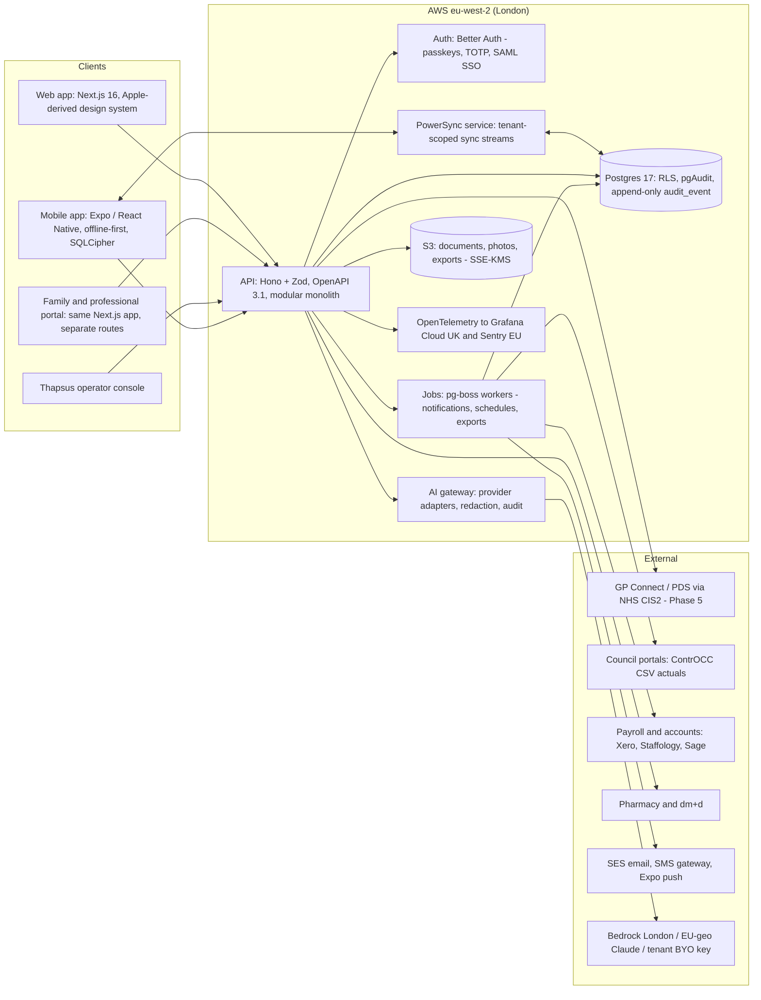
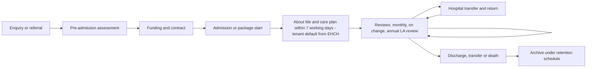
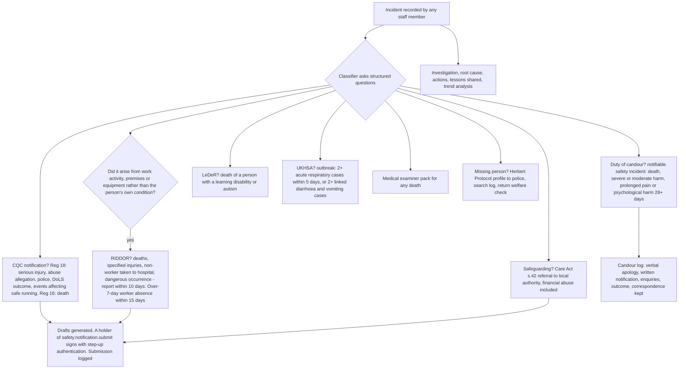
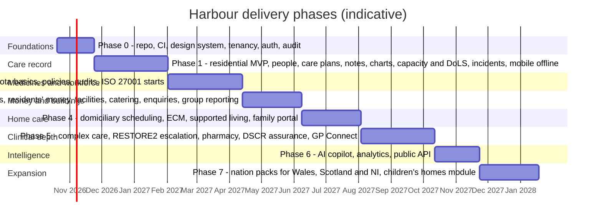

# Harbour Care Platform — Claude Code Master Build Prompt

Oct 9, 2026 · @bm

## How to use this document

This is the complete hand-off pack for building Harbour, an end-to-end management platform for UK social care providers. Part A (sections 1–2) is for you: the feature inventory and what was added beyond the original brief. Part B (sections 3–20) is the prompt itself, written to be read by Claude Code. Part C holds the research and sources behind the decisions.

**To hand it to Claude Code**

1. Export this doc to Markdown and save it as `docs/00-MASTER-PROMPT.md` inside a new, empty Git repository.
2. Open Claude Code in that folder and paste the kickoff message from section 20 (Working agreement). It tells Claude Code to read the file, set up the repo and build through all eight phases until the definition of complete in section 19 is met.
3. Claude Code then builds continuously until the definition of complete in section 19 is met. It never waits for you: open decisions take the Appendix defaults (recorded as ADRs you can change later), and anything only a person can do (CSO signature, DPO approval, certifications, NHS assurance, store review) is logged in docs/plans/human-actions.md for you to pick up after the build.

**Assumptions made in this prompt**

- Scope is UK adult social care, England-first (CQC-regulated), with Wales, Scotland and Northern Ireland handled by configuration. Service types covered: residential care homes, nursing homes, supported living, domiciliary (home care) and complex care at home. Children's homes (Ofsted-regulated) are listed as a later module, not built in Phase 1.
- The product is multi-tenant: each care provider is a tenant with its own locations, staff and data, so one codebase serves every client with per-client feature flags (including the AI module).
- "Harbour" is a working codename. Search-and-replace it with the final product name before the first external release.
- Diagrams are written as Mermaid code blocks rather than pictures so they survive the Markdown export and can be read by Claude Code.
- Thapsus owns the codebase and licenses it per client; nothing here assumes a public SaaS marketplace listing.

## Part A — For Brian

### 1. Feature summary

The prompt specifies 14 areas, about 190 features, across web, iOS and Android, delivered in 8 phases. Phase numbers refer to section 19.

| Module | Features in the prompt | Phase |
| --- | --- | --- |
| Platform core (9.1) | Multi-tenant provider, location and service setup with an optional group layer for multi-provider organisations; white-label; per-tenant feature flags and module licensing; users, roles, scopes, SSO, passkey and TOTP MFA, device management, break-glass; immutable audit log and record history; notification centre with escalation chains; versioned document store with e-signature and templates; configurable forms and assessment engine; task and workflow engine; retention schedule and legal hold; permission-aware search; migration import wizard and free full export; public API and webhooks; English and Welsh; in-app help; Thapsus operator console | 0–2, 6 |
| Service-user lifecycle (9.2) | MODS-aligned person record with NHS number; Accessible Information Standard flags; PRSB About Me; enquiry and referral pipeline with sources and conversion; pre-admission assessment; CMA-compliant contracts and fee transparency; admission, rooms, property inventory; review scheduling (care plan, LA review); hospital transfer pack and medicines reconciliation on return; discharge, transfer and death workflows; domiciliary client variant with key-safe vault; supported-living tenancy separation; family and professional sharing rules | 1, 3–4 |
| Care planning and delivery (10.1, 10.4) | PRSB-structured care plans with outcomes and contingency; positive risk assessments; locked validated tools (Waterlow, Braden, MUST, OHAT, Abbey, PAINAD, Cornell, Barthel, dependency) and NG249 multifactorial falls assessment; NEWS2 and RESTORE2 with escalation log; append-only daily notes with voice-to-text and late-entry flag; charts (fluids, food with IDDSI, repositioning, bowel, weight, vitals, glucose, oxygen, seizures, sleep, ABC, pain, continence, wounds); body maps with pressure-ulcer categories; scheduled tasks, rounds and auto-handover; activities, life story and Reg 9A visiting; end of life (ReSPECT, DNACPR, NG31, GSF); dementia and LD tools (This is me, hospital passport, health action plan, annual health checks, STOMP); PBS plans and restrictive-practice register; delegated healthcare and complex care task plans tied to competencies; CHC checklist and DST evidence; consent, MCA capacity and best-interests records, DoLS register with CQC notification and the June 2026 legal change switch | 1, 5 |
| Medicines (10.2–10.3) | dm+d-coded medicines record and reconciliation; offline administration rounds with barcode and person confirmation; time-critical rules; PRN protocols and outcomes; covert administration records; electronic controlled-drugs register with two signatures and running balances; self-administration risk assessment; homely remedies; stock, 28-day ordering, GP proxy ordering, pharmacy interface, disposal records; home-care support levels; errors and near misses with notification rules; annual review and competence gating; printable MAR and CD register | 2, 5 |
| Safety and notifications (11.1) | Incident capture with body map and photos; classifier generating CQC Reg 16/18 notifications, RIDDOR, s.42 safeguarding referrals, duty of candour workflow, LeDeR prompt, UKHSA outbreak report and medical examiner pack; falls and pressure-ulcer protocols; investigations, root cause, lessons and trends; complaints and compliments (Reg 16); whistleblowing silo; outbreak management and IPC audits; death workflow and mortality review; missing-person workflow with Herbert Protocol profile; coroner, safeguarding adults review, police and solicitor disclosure packs with a disclosure log | 1–2 |
| Quality and governance (11.2) | Data-driven compliance framework (34 quality statements now, KLOEs when CQC publishes, CIW/CI/RQIA); evidence library and inspector packs; scored audit programme and mock inspections; quality dashboard with care KPIs; PIR prefill; Capacity Tracker, ASC-WDS and devolved-nation returns; policy library with read-and-sign; statement of purpose and registration records incl. Reg 14 absence; surveys; DSPT and Cyber Essentials evidence tracker; delegated-healthcare and restrictive-practice governance | 2–3 |
| Workforce (12.1–12.2) | Applicant tracking; Reg 19 Schedule 3 pre-employment file (ID, right to work with re-checks, DBS and Update Service, history and gaps, references, conduct evidence, health, qualifications, NMC PIN); sponsor-licence compliance with Appendix D and 10-day reporting; Care Certificate (16 standards) induction; training matrix with Skills for Care topics and Oliver McGowan tiers; SCORM/xAPI e-learning and LMS integration; LDSS claim tracking; observed competence sign-offs that gate actions; supervision and appraisal scheduler; employee relations casework (disciplinary, grievance, capability, appeals, DBS and NMC referrals) and staff data protection; qualifications and NMC revalidation planner | 2 |
| Rostering, time and pay (12.3) | Dependency-based safe staffing planner; rota builder with skills, continuity, swaps, bank and agency; Working Time compliance (48-hour, rest, breaks, sleep-ins, travel time); clock-in and visit-based time and attendance; pay rules engine (NMW checks, enhancements, 12.07% holiday accrual, rolled-up holiday pay, SSP 2026, guaranteed-hours readiness); payroll and pension exports (Xero, Staffology, Sage, BrightPay); agency and AWR tracking; absence; wellbeing and voice surveys; lone-worker check-ins and BS 8484 devices | 2 |
| Operations (13) | Bed board and occupancy; enquiry SLA and conversion; vacancy publishing; domiciliary packages, run optimisation, ECM visit verification (NFC/QR/GPS) with tolerance windows and missed-visit alarms, live-in care, key safe access, client communications; supported living hours and tenancy; asset register and statutory compliance calendar (LOLER, gas, electrical, legionella, fire, windows, bed rails); PEEPs and power-cut evacuation lists; maintenance; housekeeping and IPC; vehicles; dietary profiles, allergen matrix, IDDSI menus, Natasha's Law labels, food safety logs; activities programme; visitor kiosk; appointments and transport; residents' and relatives' meetings; day-service sessions and attendance; nightly downtime pack | 3–4 |
| Finance (14) | Per-person funding mix (LA, FNC, CHC, s.117, self, top-ups, DP, ISF, PHB) with versioned rates; regulated top-up agreements; commissioner contracts (block, spot, framework); CMA-aligned self-funder terms; DWP 28-day flags and personal expenses allowance; deferred payment records; charge generation and pro-rata; invoices, credit notes, Direct Debit; council portal export and three-way reconciliation; FNC and CHC claims; debtors; accounting sync with VAT exemption handling; residents' personal ledgers with two-signature controls; appointee and deputy reporting; valuables; petty cash; location P&L, occupancy and fee analytics, home-care unit economics, purchasing, payroll costing | 3 |
| Communication and portals (15.1) | Family portal and app mode (updates, consented care plan, visit booking, messaging, invoices, surveys, documents); person's own portal (About Me, feedback); time-limited professional access; internal messaging and announcements; handover acknowledgement; letter templates; optional public website module with vacancies and fees | 1, 4 |
| Reporting and integrations (15.2–15.3) | Role dashboards; governed report builder; opt-in benchmarks; statutory outputs; warehouse export; adapters for GP Connect, PDS, CIS2, NHSmail, pharmacy and dm+d, council portals, payroll and accounts, IDSP and DBS, SCORM, nurse call and sensors, lone-worker devices, Bluetooth vitals, communications, directories, e-signature and OCR, public API | 1–6 |
| AI Management Copilot (16) | Optional, off by default, per-tenant provider choice: Ask Harbour over governed data; draft handovers, reports, letters, policies and notification wording; deterministic compliance monitor with plain-English explanations; inspection preparation; rota suggestions; finance commentary; voice-to-text structuring; guardrails: no clinical reasoning, no automated decisions, pseudonymisation, UK or EU-geo inference, full audit, evaluation and red-team suite, kill switch | 6 |
| Mobile apps (17) | One Expo codebase, iOS and Android, Care, Manage, Family and Kiosk modes; full offline for notes, charts, eMAR, incidents, rota, visits and training; SQLCipher store, biometric lock, remote wipe, root detection, screenshot blocking; store compliance (privacy labels, health declarations, account deletion, iOS 26 SDK, API 36); public or private distribution; phased rollouts | 1–4 |

### 2. What your brief did not mention, and why it is in the prompt

Your brief asked for an end-to-end system, GDPR compliance, all care types, iOS and Android apps, an Apple.com-style web UI, version control and an optional AI module. The research surfaced 26 things that a buyer, CQC or the NHS will expect and that competitors either charge extra for or do badly.

| Addition | Why it matters | Where |
| --- | --- | --- |
| Multi-tenant architecture with per-client feature flags | Lets Thapsus sell one product to many providers and switch modules (incl. AI) on per client without forks | 4, 6, 9.1 |
| Clinical safety (DCB0129) and a named Clinical Safety Officer | Required to join the NHS assured DSCR supplier list and expected by councils buying care tech; also the discipline that stops a medication bug hurting someone | 5.2 |
| NHS assured DSCR roadmap: MODS, PRSB, dm+d, GP Connect, DSPT, Cyber Essentials Plus, ISO 27001, annual pen test | About 80% of providers already use a DSCR; councils fund only assured products; the IG uplift from 1 Sept 2026 makes ISO 27001 mandatory for assured suppliers | 5.3, 15.3, 19 |
| Medical-device boundary | If Harbour (or its AI) applied automated reasoning to clinical data it would be regulated by the MHRA as software as a medical device; the prompt keeps every feature on the right side of that line | 5.2, 16.2 |
| Offline-first mobile with encrypted local store | Connectivity is a barrier for 40% of providers and poor offline behaviour is the top complaint about existing products | 6, 17 |
| Full electronic MAR with controlled-drugs register | Medicines are the most inspected area in adult social care; a care system without eMAR forces a second product | 10.2 |
| Mental capacity, best interests and DoLS register | Reg 11 consent and DoLS notifications are inspected; the law changed on 2 June 2026 so the workflow is configurable | 10.4 |
| Statutory notification engine (CQC, RIDDOR, safeguarding, duty of candour, LeDeR, UKHSA, medical examiner) | Missed or late notifications are a common enforcement finding; one incident can trigger six different duties | 11.1 |
| Configurable compliance framework | CQC has consulted on replacing the 34 quality statements with KLOEs from end-2026 (go-live unconfirmed at 9 October 2026); hard-coding today's framework would date the product within a year | 11.2 |
| Statutory returns prefill (Capacity Tracker, PIR, ASC-WDS) | Mandated monthly and yearly reporting that managers currently retype; a visible time-saver in sales demos | 11.2 |
| Residents' personal money ledgers | Financial abuse is defined in Reg 13; managers are inspected on it; almost no competitor does it well | 14.3 |
| Funding complexity (FNC, CHC, s.117, top-ups, DPAs, DWP 28-day rule) and council portal reconciliation | Billing errors are where providers lose money; the regulated top-up agreement has mandatory fields | 14.1–14.2 |
| Employment-law engine (NMW incl. travel time and sleep-ins, 12.07% holiday, SSP 2026, guaranteed hours 2027) | The Fair Work Agency can issue penalties from April 2026; rostering software that gets pay wrong creates liability | 12.3 |
| Sponsor-licence compliance | Many providers employ sponsored overseas workers; Home Office reporting is within 10 working days and the route is closing by 2028 | 12.1 |
| Oliver McGowan training and the 16-standard Care Certificate | Statutory training under the 2025 Code of Practice; providers must evidence completion | 12.2 |
| Statutory premises calendar (LOLER, legionella, gas, electrical, fire, windows, bed rails) | Reg 15 and HSE prosecutions; a maintenance log without the legal frequencies is useless | 13.4 |
| Domiciliary electronic call monitoring | Councils require real-time visit verification and tolerance-window alarms in their contracts | 13.2 |
| Family and person portals with consent model | Underused across the sector; a differentiator for self-funder marketing and a CQC Caring evidence source | 15.1 |
| Data portability out and migration in | Providers regret purchases and switch; being charged for your own data is a known grievance, so the export is free and guaranteed | 5.1, 9.1 |
| Retention schedule, DSAR workbench, breach and complaints registers | GDPR in practice, not on paper; the complaints duty went live 19 June 2026 | 5.1 |
| Accessibility (WCAG 2.2 AA) and Welsh language | Required by councils and the Accessible Information Standard; Welsh Active Offer for Welsh tenants | 5.4 |
| Private (enterprise) app distribution option | Large tenants with MDM may not want a public listing; the choice cannot be reversed after first approval | 17.3 |
| Lone-worker safety | HSE duty for home-care providers; cheap to build, strong in sales | 12.3 |
| Enquiry CRM, bed board and unit economics | The commercial side providers run in spreadsheets; links directly to occupancy and revenue | 13.1, 14.4 |
| Thapsus operator console | You need tenant onboarding, metering, billing and audited support access from day one | 9.1 |
| Children's homes and devolved nations as later phases | Adjacent markets with different regulators (Ofsted, CIW, Care Inspectorate, RQIA) that reuse most of the platform | 19 |

**Things outside the prompt that you will need to arrange** (also in the Appendix): a registered clinician to act as Clinical Safety Officer; a Data Protection Officer or named lead; a design-partner care home for weekly feedback; Apple Developer and Google Play accounts in the name of Thapsus Cargo Ltd; cyber and professional indemnity insurance; Cyber Essentials Plus certification; a pricing model (per bed or per client per month, with AI as an add-on) and a decision on whether to pursue NHS DSCR assurance before the supplier-pays model starts on 1 October 2027.

## Part B — Master prompt for Claude Code

### 3. Mission, context and how to read this

You are the founding engineering team for **Harbour**, a multi-tenant platform that runs a UK adult social care provider end to end: from the first enquiry to the last invoice, and from the founder's board report to the carer's 7 a.m. medication round. Harbour is built and owned by Thapsus Cargo Ltd (trading as Thapsus) and licensed to care providers as a subscription. Everything you build must be safe for the people being cared for, defensible to the Care Quality Commission (CQC) and the Information Commission, and usable by a care worker on a cracked Android phone in a basement with no signal.

**Your goal**: build the complete Harbour platform described in sections 4–18 (every feature in Part A, all eight phases, web, iOS and Android) to the definition of complete in section 19, and keep working until it is reached. You do not stop for approvals. Regulatory sign-offs, certifications and assurance submissions are Brian's work after the build; your job is to produce the code, tests, documentation and evidence they need. The only acceptable pause is a hard technical blocker that no default in this document resolves, and even then you log it in `docs/plans/human-actions.md`, build against a mock and continue with the next item.

**Who uses it**

- Provider staff from founder to carer: Nominated Individual, directors, regional and registered managers, deputies, nurses and clinical leads, team leaders, care and support workers, care coordinators, activities, catering, housekeeping, maintenance, administrators, finance, HR, training and quality leads.
- People who draw on care and their families, attorneys and deputies.
- External professionals with scoped access: GPs, district nurses, social workers, commissioners, pharmacies, CQC inspectors (evidence packs), agency staff.
- Thapsus staff: tenant onboarding, support and billing through a separate operator console.

**Sector facts that shape the design** (sources in Part C)

- CQC regulates on 5 key questions (safe, effective, caring, responsive, well-led) and 34 quality statements, scored 1–4. A new framework with key lines of enquiry (KLOEs) is being piloted for implementation from end-2026, so the compliance model must be configurable, not hard-coded.
- Around 80% of providers already use a digital social care record (DSCR). The buyers' top complaints are cost, poor offline behaviour, slow support, and being charged to get their own data back. Connectivity is a barrier for 40% of providers.
- Money is complicated: one resident can be funded by a council, the NHS (FNC or CHC), a third-party top-up and their own savings at once, with councils paying through portals that expect uploaded "actuals".
- Workforce law is changing fast: NLW £12.71 from April 2026, day-one SSP from April 2026, guaranteed-hours duties in 2027, a Fair Pay Agreement expected in 2028, and sponsor-licence duties for providers employing overseas staff.
- Clinical safety is regulated: a product that holds care records must follow DCB0129 (hazard log, clinical safety case, named Clinical Safety Officer) to join the NHS assured DSCR list, and must stay outside the definition of a medical device.

**Non-negotiable principles, in priority order**

1. Safety of the person receiving care beats every other concern.
2. Compliance is a feature: every regulated action produces the record the regulator will ask for.
3. Offline-first for anything a care worker does at the point of care.
4. Configurable, never forked: one codebase, per-tenant settings and feature flags.
5. UK data residency, least privilege, immutable audit, no personal data in logs.
6. Accessible (WCAG 2.2 AA) and plain English; British spelling; no emoji anywhere in the UI.
7. Ship vertical slices that a real care home can use, with tests, before widening scope.

**Reading order**: sections 4–8 are the constraints and architecture you must honour; 9–17 are the module specifications; 18 is the data model; 19 is the delivery plan and the definition of complete; 20 tells you exactly how to start and how to keep going. Where a specification and a regulation disagree, the regulation wins and you raise it in `docs/decisions/`.

### 4. Tenants, services, roles and permissions

One codebase serves many providers. A **tenant** is a provider organisation (one CQC provider ID). A tenant has **locations** (each with a CQC location ID and ODS code), and each location runs one or more **services** of a service type: residential, nursing, supported living, domiciliary, complex care at home, live-in, respite, day service. Service type drives which modules and record templates are active. An optional **group** sits above tenants for multi-provider organisations and acquirers: consolidated read-only reporting, a shared policy library and staff transfers between group tenants (TUPE import), while each tenant keeps its own data isolation. Tenants in Wales, Scotland and Northern Ireland load a nation pack (regulator framework and returns, worker registration, capacity and safeguarding statutes, charging rules) by configuration (sections 9.1, 11.2 and Phase 7).

**Access model**: role-based access control (RBAC) for what a person may do, combined with attribute-based scoping for whom they may do it to: location, team, assigned service users, and time window (agency and visiting professionals get an expiry). Every permission check is server-side and enforced again by Postgres row-level security. A **break-glass** path lets an authorised manager open a record outside their scope with a typed justification; it alerts the Registered Manager and the data protection lead and is reported weekly.

| Role (built-in, tenant may rename or clone) | Typical holder | Scope | Representative permissions |
| --- | --- | --- | --- |
| Owner | Founder, director, Nominated Individual (Reg 6) | Tenant | Everything incl. billing, feature flags, role design, data export, DPIA sign-off |
| Group executive | Operations director, regional manager | Group or many locations | Cross-location dashboards, finance, workforce, audits; no clinical edits unless also clinical |
| Registered Manager | Reg 7 manager, deputy when acting up | Location | Full operational control: care records, incidents, notifications to CQC, rota approval, recruitment sign-off |
| Deputy manager | Deputy, head of care | Location | As Registered Manager minus tenant settings; may submit CQC notifications only under a time-boxed acting-up grant |
| Clinical lead / nurse | RGN, RMN, RNLD; NMC PIN verified | Location or caseload | Clinical assessments, controlled drugs, delegated-healthcare sign-off, ReSPECT recording, NEWS2 escalation |
| Team leader / senior carer | Shift leader, field care supervisor | Team or shift | Handover, task allocation, eMAR administration, incident reporting, spot checks, competency observation |
| Care worker / support worker | Carer, HCA, PA | Assigned people only | Daily notes, charts, eMAR administration within competence, incidents, own rota and timesheets |
| Care coordinator | Domiciliary scheduler | Service | Scheduling, visit monitoring, client package changes, on-call escalation |
| Activities, catering, housekeeping, maintenance | Non-care staff | Location | Only their module: menus and allergen flags, cleaning and maintenance logs, activity records; no care notes |
| Administrator / receptionist | Admin | Location | Enquiries, visitors, documents, appointments; read-only demographics |
| Finance | Finance manager, bookkeeper | Tenant | Fees, invoicing, residents' money oversight, payroll export, budgets; no care notes |
| HR / recruitment / training lead | HR, L&D | Tenant | Recruitment, compliance files, training matrix, supervision records; no care notes |
| Quality and compliance lead | Quality manager, DPO, Caldicott Guardian, Freedom to Speak Up Guardian | Tenant | Audits, policies, evidence library, DSAR and breach registers, IG, whistleblowing (anonymised view) |
| External professional | GP, district nurse, pharmacist, social worker, commissioner | Named people, time-limited | Read scoped record sections; write only their own entries (e.g. visit note, medication review) |
| Family / representative | Next of kin, LPA attorney, deputy | One person | Portal: updates, consented sections of the care plan, invoices, messages, visit booking; attorneys see finance where their LPA covers it |
| Person receiving care | Resident, client, tenant of supported living | Self | Portal: About Me authoring, their own notes feed, preferences, feedback |
| Agency / bank worker | Temporary staff | Shift window | As care worker, auto-expiring at shift end plus 2 hours |
| Inspector / auditor | CQC, LA contracts officer, Reg 44 visitor (children's later) | Evidence pack | Read-only, time-boxed, watermarked exports |
| Thapsus operator | Support engineer | Tenant on request | Impersonation only with tenant approval ticket; every action audited and visible to the tenant |

**Implementation rules**

- Permissions are named `module.resource.action` (e.g. `care.emar.administer`, `finance.ledger.approve`). Roles are bundles of permissions plus scope rules, stored per tenant and versioned.
- Separation of duties is enforced where the regulator expects it: two distinct users for controlled-drug administration and for residents' money transactions above the tenant's limit; the person who records an incident cannot close it; CQC notifications are submitted only by holders of the safety.notification.submit permission (by default the Registered Manager and the Nominated Individual, extendable by a time-boxed acting-up grant during a Reg 14 absence).
- Delegation and acting-up are time-boxed grants, not role edits.
- Every user action writes to the audit log with actor, scope, device, IP, and the justification where required.

### 5. Non-negotiables: data protection, clinical safety, security, accessibility, audit

These are acceptance criteria for every phase, not a later hardening pass. Each has a checklist in `docs/compliance/` that CI links to.

**5.1 UK GDPR and Data Protection Act 2018 (as amended by the Data (Use and Access) Act 2025)**

- Roles: the care provider is the controller; Thapsus is the processor. Ship a signed Article 28 data processing agreement template and a sub-processor register (hosting, email, SMS, AI provider) that tenants can see in-app.
- Lawful basis is recorded per processing purpose in a records-of-processing register: care delivery under Art 6(1)(b)/(f) (independent providers) or 6(1)(c)/(e) (public bodies) with Art 9(2)(h) and DPA 2018 Sch 1 para 2 for health and social care purposes; employment under Sch 1 para 1; safeguarding under Sch 1 para 18 and the new recognised legitimate interest for safeguarding a vulnerable individual. Never use consent as the basis for care records; consent governs only optional things (photos in the family portal, marketing, AI processing of free text).
- Data-subject rights tooling: a DSAR workbench for residents, families and staff that collects every record about a person across modules, redacts third parties, tracks the one-month clock (extendable to three months), pauses the clock while awaiting ID or clarification, and exports a bundle. Rectification, erasure (where retention law allows) and portability are built in.
- Breach register with a 72-hour ICO clock, severity assessment, and a template to notify data subjects; processor-to-controller notification is automatic in-app.
- Complaints route: in-product data-protection complaint form, 30-day acknowledgement, outcome tracking (duty live since 19 June 2026).
- Automated decisions: Harbour never makes solely automated significant decisions about people. The AI module (section 16) is advisory only and respects Arts 22A–D.
- A DPIA template is pre-filled for each tenant from their configuration; the tenant's DPO (or named lead) signs it in-app before go-live. DPO details, Caldicott Guardian and SIRO roles are recorded per tenant.
- Retention engine: a per-record-type schedule with legal holds. Defaults: care records and MAR charts 8 years after care ends (NHS Records Management Code; CQC sets no period), controlled drugs registers 2 years from last entry (statutory), complaints 10 years, serious incidents 20 years, RIDDOR 3 years, staff files 6 years after leaving or to the 75th birthday, whichever the tenant selects under the Code, training records 10 years, rosters and timesheets 6 years (NMW record-keeping), working-time opt-outs and records 2 years, financial records 6 years, CCTV per the tenant's policy. Deletion is soft, then cryptographically shredded after the schedule, with a destruction certificate.
- Data portability out: a tenant can export their full dataset (CSV and JSON, with documents) at any time, free, in a documented schema (also satisfies the DSCR data-migration standard). Being charged for your own data is a competitor complaint we will never earn.
- National data opt-out is honoured where publicly funded care data is used beyond direct care (reporting to NHS); flag per person.
- Caldicott principle 7 (the duty to share for direct care) is reflected in the external-professional access model.

**5.2 Clinical safety (DCB0129 / DCB0160)**

- Maintain a clinical risk management plan, a hazard log (`docs/clinical-safety/hazard-log.md`, exported to the regulator's format), and a clinical safety case report per release. Thapsus names a Clinical Safety Officer (a registered clinician; see Appendix). Tenants are offered a DCB0160 deployment template.
- Hazards that must be in the log from day one: wrong-person record selection, stale offline data shown as current, missed or duplicated medication administration, unit or dose transcription errors, alert fatigue, silent sync failure, incorrect allergy display, time-zone and daylight-saving errors on time-critical medicines.
- Medical-device boundary: Harbour stores, displays and transmits care information and applies rules the tenant configures. It must not apply automated reasoning to produce a diagnosis, prognosis, risk score or treatment recommendation. Validated tools (NEWS2, MUST, Waterlow) are calculated exactly as published, show the formula, and link to the tenant's escalation policy. Record this boundary in `docs/compliance/medical-device-boundary.md` and re-check it in every PR that touches clinical features.

**5.3 Security**

- Targets: OWASP ASVS 5.0 Level 2 for web and API; OWASP MASVS Level 2 for mobile; organisational certifications (Cyber Essentials Plus, ISO 27001 and the annual external penetration test that the DSCR assurance uplift of 1 September 2026 makes mandatory for assured suppliers) are Thapsus's work outside the codebase: the build produces the control mapping and evidence for them in docs/compliance and never waits for them.
- Authentication: passkeys (FIDO2) and TOTP apps as MFA, SMS only as a documented exception; MFA mandatory for every role that can read care records; step-up re-authentication for controlled drugs, residents' money, data export and break-glass. Passwords follow NCSC: minimum 12 characters, deny-list, no forced expiry, throttling not lockout. Device PIN or biometric unlock on mobile with auto-lock as set in section 17.2 (2 minutes on personal devices, 30 seconds by default on shared and kiosk devices, where the MDM-enrolled device is the possession factor).
- Transport TLS 1.2+; data encrypted at rest (AES-256) including the mobile SQLite store (SQLCipher) and backups; secrets in a managed secret store, never in the repo; keys rotated yearly.
- Logging: security logs retained at least 6 months, UTC timestamps, tamper-evident, and scrubbed of personal data; structured application logs use opaque IDs only.
- Vulnerability management: critical and high (CVSS 7+) fixes deployed within 14 days; Renovate for dependencies; CodeQL, gitleaks and Trivy/Syft SBOM in CI; signed releases with provenance attestations.
- Tenant isolation: `tenant_id` on every row, Postgres row-level security with `FORCE ROW LEVEL SECURITY`, the application connects as a non-owner role and sets `app.tenant_id` per transaction; integration tests prove cross-tenant reads fail through the API and through PowerSync sync streams (logical replication bypasses RLS, so stream filters are tested on their own).
- Session and device management: list and revoke sessions and devices; remote wipe of the mobile cache on device loss; jailbreak/root detection warns and blocks eMAR.

**5.4 Accessibility and language**

- WCAG 2.2 AA on web and mobile, verified by axe-core in CI and by manual screen-reader passes each release. Target sizes 44×44 px, visible focus, text resizing to 200%, reduced-motion respected, no information carried by colour alone.
- Accessible Information Standard: every person's record carries communication and information needs (SNOMED-coded) that flag on every screen and print.
- All UI strings pass through i18n (ICU message format). English first; Welsh translation files and the Welsh "Active Offer" flag ready for Welsh tenants; British English spelling and date formats (dd/mm/yyyy, 24-hour time).

**5.5 Audit trail**

- Every create, update, delete, view of a care record, export, login, permission change and sync event is written to an append-only `audit_event` table (no UPDATE or DELETE grants) with actor, role, scope, tenant, device, IP, before/after hashes and, where captured, the reason. pgAudit is enabled at the database level.
- Care notes and observations are immutable events; corrections are new events that reference the original, shown as strike-through with the correction, time and author (the electronic equivalent of the single-line correction the regulator expects).
- Every record can produce a human-readable history view and a signed PDF export for inspectors, coroners and courts.

### 6. Architecture and technology stack

A TypeScript monorepo, a modular monolith API over Postgres, a Next.js web app, one Expo app for iOS and Android, and a sync service that makes the mobile app work offline. Everything runs in the AWS London region. Decisions below are defaults; change one only through an ADR (section 7).



| Layer | Decision | Why |
| --- | --- | --- |
| Monorepo | pnpm workspaces + Turborepo; TypeScript 6.x strict (move to 7 when Next, Expo and Drizzle certify it); Biome for lint and format | One language end to end; shared Zod schemas, types and clients between web, mobile and API |
| Web | Next.js 16 (App Router, React 19); Tailwind CSS 4 with design tokens from section 8; Radix primitives for accessible components. Server components read through the typed API client; server actions and route handlers call the same client for writes. The web tier never opens a database connection | Mature, accessible, fast; renders the Apple-style marketing pages and the dense management UI from one design system; one data path keeps tenancy enforcement in the API |
| Mobile | Expo SDK 57+ / React Native New Architecture, expo-router with native stack and tabs; EAS Build, Submit and Update; Maestro for E2E | One codebase for iOS and Android; native navigation components adopt Liquid Glass on iOS 26 and Material 3 on Android automatically |
| Offline sync | PowerSync (self-hosted in London; FSL licence; needs its own bucket-storage Postgres, provisioned in infra) with sync streams filtered by the JWT's `tenant_id`, location and assignment claims; client writes go to an upload queue and are applied by the API, which is authoritative | Postgres-native, server-authoritative, works on web and RN. Fallback: Electric (read sync) plus the same write API |
| Conflict model | Care notes, observations, eMAR administrations and incidents are append-only events with client UUIDs and idempotent inserts (no conflicts). Care plans, rotas and demographics are mutable aggregates with optimistic `expected_version`; a stale write is rejected and surfaced as a review task, never silently overwritten | Matches how regulators treat records: nothing is lost, every change is attributable |
| API | Hono with Zod validation; OpenAPI 3.1 generated from code; one typed client (Hono RPC or OpenAPI-generated) used by web and mobile; webhooks for integrators. No second RPC layer | Small, fast, typed; one contract for the apps and for partners |
| Domain structure | Modular monolith with 14 bounded contexts: `platform`, `people`, `care`, `medicines`, `safety`, `quality`, `workforce`, `scheduling`, `operations`, `finance`, `comms`, `insights`, `integrations`, `ai`. These are the only module names used in sections 9–16, permission prefixes, commit scopes and `packages/domain/`. Modules talk through domain events on a transactional outbox; no cross-module table joins | Lets two people move fast now and split services later only if needed |
| Database | Postgres 17 (RDS Multi-AZ in production; Docker locally); Drizzle ORM and Drizzle Kit migrations; `tenant_id` + RLS; pgAudit; temporal history tables for mutable aggregates; Postgres full-text search first | One source of truth; row-level isolation; no extra search cluster until needed |
| Jobs and schedules | pg-boss (at-least-once delivery with idempotent handlers, cron) for reminders, compliance clocks, exports, integrations; Temporal only if workflows outgrow it | Keeps infrastructure to Postgres |
| Files | S3 (eu-west-2) with SSE-KMS, presigned uploads, antivirus scan on ingest, image EXIF stripping; PDF generation with Typst (tagged, PDF/UA) and Playwright for HTML fidelity | Accessible, signed exports for inspectors and families |
| Auth | Better Auth (organisations plugin for tenants, passkeys, TOTP, device sessions); SAML/OIDC SSO via WorkOS or the Better Auth SSO plugin for enterprise tenants; NHS CIS2 onboarding when GP Connect is built | NCSC-grade MFA without a separate identity server to run; Keycloak is the documented alternative if a client demands self-hosted identity |
| Messaging | Amazon SES (London) for email; UK SMS gateway behind an interface; Expo push (APNs/FCM); NHS Notify only if social-care eligibility is confirmed | Residency and deliverability |
| Feature flags | OpenFeature SDK with Flagsmith (self-hosted) as provider; flags per tenant, per location, per role | Per-client optional modules (AI, finance, domiciliary) without forks |
| Observability | OpenTelemetry traces, metrics and logs to Grafana Cloud UK region; Sentry (EU region) for errors; synthetic checks; public status page | Diagnose offline and sync issues quickly; prove uptime to tenants |
| Infrastructure | Terraform (OpenTofu-compatible) for AWS: ECS Fargate services, RDS, S3, CloudFront, WAF, KMS, Secrets Manager, CloudWatch; separate accounts for dev, staging, prod; Docker Compose for local | Reproducible, auditable, UK-resident |
| AI | Internal AI gateway (section 16) with adapters: Amazon Bedrock in-Region London models by default; Claude via Bedrock EU-geo or the Anthropic API with zero-data-retention under contract; tenant BYO key. Provider chosen per tenant; redaction before send; full prompt/response audit | Keeps the AI optional, swappable and inside the DPIA |

**Hosting and residency rules**: production personal data lives only in the AWS London region (eu-west-2). Postgres runs on RDS Multi-AZ by default; Supabase's London region is permitted for dev, staging and pilot tenants by ADR provided `FORCE ROW LEVEL SECURITY`, pgAudit and logical replication for PowerSync are enabled. AWS has no second UK region, so disaster recovery is Multi-AZ plus point-in-time recovery (section 7) and the mobile app's offline mode is the business-continuity path; record this as a deliberate decision in ADR-0001. Vercel (`lhr1`) or Fly.io (`lhr`) may host the stateless web tier, never the database or files. Do not use hosts without a UK region for anything holding personal data (Railway, Render and Hetzner have none; Cloudflare's jurisdiction restriction has no UK option). Model inference that leaves the UK must be disclosed in the sub-processor register and the DPIA.

**Performance budgets**: web first contentful paint under 1.5 s on a mid-range laptop; mobile cold start under 2 s and every point-of-care action under 100 ms from local SQLite; sync of a 60-bed home's active data set under 30 s on 4G; all list screens virtualised.

### 7. Repository, code quality, version control and release process

One Git repository, trunk-based, with every change reviewed and every release reproducible. Set this up in Phase 0 before any feature code.

**Repository layout**

```
harbour/
  apps/
    web/            Next.js app (marketing, management UI, portals)
    mobile/         Expo app (care worker, manager, family modes)
    api/            Hono API, workers, sync upload handlers
    operator/       Thapsus operator console (can start as routes in web)
  packages/
    domain/         Bounded-context modules (the 14 in section 6): entities, rules, events (no I/O)
    db/             Drizzle schema, migrations, RLS policies, seed data
    contracts/      Zod schemas, OpenAPI, generated clients, event types
    ui/             Design system: tokens, components, icons, motion
    ui-native/      React Native components sharing the same tokens
    sync/           PowerSync stream definitions and client helpers
    i18n/           en-GB and cy message catalogues
    config/         Shared tsconfig, Biome, Vitest, Playwright configs
  infra/            Terraform modules and environments (dev, staging, prod)
  docs/
    00-MASTER-PROMPT.md       this document
    01-CONSTRAINTS.md         two-page digest of sections 4-7 and 20, imported by CLAUDE.md
    02-SOURCES.md             Part C of this document, moved out of the prompt
    plans/                    phase plans (phase-0.md ...) and session summaries
    decisions/                ADRs (MADR 4 template), numbered
    specs/                    one spec per module, kept current; rates.md for statutory figures
    compliance/               GDPR, security, accessibility, kiosk checklists; medical-device boundary
    clinical-safety/          risk management plan, hazard log, safety case per release
    runbooks/                 on-call, incident response, restore, tenant onboarding
  .claude/           CLAUDE.md imports, skills, agents, settings
  .github/           workflows, CODEOWNERS, PR and issue templates, dependabot/renovate
```

**Version control rules**

- Default branch `main` is protected: no direct pushes, required status checks, linear history, signed commits. During the autonomous build a PR merges automatically when every quality gate passes and the relevant reviewer agent approves; Claude Code commits under its own GitHub App or bot identity, and Brian reviews asynchronously from the merged history, opening issues or reverting where needed. Required human review is switched on before the first real tenant goes live.
- Short-lived branches named `feat/<area>-<slug>`, `fix/…`, `chore/…`, `docs/…`; rebase on `main`; delete after merge.
- Conventional Commits enforced by commitlint (`feat(care): add repositioning chart`). Scopes are the bounded contexts plus `web`, `mobile`, `api`, `infra`, `docs`.
- Changesets generate CHANGELOG entries and semantic versions per package; the platform has a single release version `vMAJOR.MINOR.PATCH` with mobile build numbers derived from it.
- Pull requests use the template: what and why, screenshots or recordings for UI, migration notes, clinical-safety impact (none / hazard IDs touched), data-protection impact, test evidence, rollout and rollback plan. CODEOWNERS routes `packages/db`, `packages/domain/medicines`, `infra` and `docs/clinical-safety` to a required reviewer.
- Every ADR records context, options, decision and consequences; ADR-0001 is this stack. Superseded ADRs stay in the repo with a pointer.
- Secrets never enter Git: gitleaks pre-commit and CI; `.env.example` only.

**Quality gates (CI on every PR; all must pass)**

| Gate | Tooling | Rule |
| --- | --- | --- |
| Types and lint | `tsc --noEmit`, Biome | Zero errors; no `any` without a justified `// why` comment |
| Unit and domain tests | Vitest | Domain packages at 90% line coverage; every regulatory rule (retention, NMW, holiday accrual, MAR validation) has table-driven tests |
| Database | Drizzle migration check, RLS test suite | Migrations are forward-only and reversible by a new migration; a test proves each table denies cross-tenant access |
| API contract | OpenAPI diff | Breaking changes need a major version and a migration note |
| Web E2E | Playwright against a seeded tenant | Smoke journeys for each module; axe-core accessibility scan with zero serious violations |
| Mobile E2E | Maestro flows on iOS simulator and Android emulator | Login, offline note, eMAR round, sync recovery |
| Security | CodeQL, gitleaks, Trivy image scan, Syft SBOM, `pnpm audit` | No critical or high findings |
| Performance | Lighthouse CI for web; bundle size budgets for mobile | Budgets in section 6 |
| Docs | Markdown lint; spec and hazard log updated when the PR label says `clinical` or `data-protection` | PR fails if the label is present and the files are untouched |

**Environments and release**

- `dev` deploys from every merge to `main`; `staging` on tagged release candidates with a production-like anonymised dataset; `prod` on signed tags after a manual approval by Brian, a human action logged in docs/plans/human-actions.md that the build never waits for. Terraform plans are posted to the PR; applies run only from `main` with OIDC, no long-lived cloud keys.
- Releases ship on a two-week train. Mobile: EAS Build to TestFlight and Google Play internal testing on each release candidate; store submission with the release; EAS Update only for JavaScript and asset fixes within the published binary's native capabilities, as the store rules require.
- Database changes use expand-and-contract so the previous app version keeps working during rollout; the mobile app tolerates one schema version behind.
- Every production release has a signed SBOM and provenance attestation, release notes in plain English for tenants, a clinical safety case delta, and a rollback that is tested in staging.
- Backups: automated daily snapshots plus point-in-time recovery, retained 35 days, restore drill quarterly and documented in `docs/runbooks/restore.md`; RPO 15 minutes, RTO 4 hours.

**Working with Claude Code (repo conventions)**

- `CLAUDE.md` at the root (short): how to run and test each app, the commit and PR rules above, the no-personal-data-in-logs rule, the design-token rule, the clinical-safety and medical-device boundary pointers, and `@docs/01-CONSTRAINTS.md` imported for context (a two-page digest; the master prompt is referenced, not imported, so sessions stay small).
- `.claude/skills/`: `new-module` (scaffold a bounded context with spec, schema, API, UI, tests), `add-migration`, `release`, `hazard` (append to the hazard log), `adr` (new MADR file).
- `.claude/agents/`: `security-reviewer`, `clinical-safety-reviewer`, `accessibility-reviewer` used before merging anything labelled accordingly.
- Hooks: block commits containing `.env`, run Biome and type checks pre-commit, and refuse any PR that touches `packages/domain/medicines` without updating tests.

### 8. Design system: Apple.com-derived web UI, native conventions on mobile

The web app borrows Apple.com's discipline, not its assets: one typeface family, a narrow palette, a 980 px content column, big quiet headlines, pill buttons, translucent navigation, and motion that only ever clarifies. Two surfaces share the tokens: the **public and marketing pages** (full Apple.com rhythm: hero headline, product sections, "Learn more" link pairs) and the **product shell** (the same tokens applied to a dense, calm management interface in the manner of iCloud.com and macOS System Settings: light grey canvas, white cards, hairline borders, a 44 px translucent top bar, a collapsible sidebar).

**Licensing rule**: Apple's San Francisco fonts may not be embedded in websites or non-Apple software. Use the system font stack so Apple devices render SF legally, with self-hosted Inter (SIL OFL) elsewhere: `-apple-system, BlinkMacSystemFont, "Inter", "Segoe UI", Roboto, Helvetica, Arial, sans-serif`. Enable Inter features `tnum` (tabular numbers in tables), `cv11`, `ss01` as needed. Never ship SF Pro files or SF Symbols; use Lucide icons (ISC licence) tuned to 1.5 px stroke.

**Tokens** (implement as CSS custom properties in `packages/ui/tokens.css` and as a TypeScript object for React Native)

| Token group | Values |
| --- | --- |
| Colour, light | `--bg: #ffffff`; `--bg-secondary: #f5f5f7`; `--text: #1d1d1f`; `--text-secondary: #6e6e73` (5:1 on white, AA for body); `--text-tertiary: #86868b` (large text or on dark only); `--border: #d2d2d7`; `--link: #0066cc`; `--accent: #0071e3`, hover `#0077ed`; `--success: #1a7f36`; `--warning: #b25000`; `--danger: #d70015`; `--info: #0071e3` |
| Colour, dark | `--bg: #000000`; `--bg-secondary: #1d1d1f`; `--card: #161617`; `--text: #f5f5f7`; `--text-secondary: #86868b`; `--border: #424245`; `--link: #2997ff`; nav `rgba(22,22,23,0.8)` |
| Clinical status colours | Fixed semantic set independent of theme, always paired with an icon and a word: overdue (danger), due within window (warning), done (success), not applicable (secondary). Never colour-only |
| Type scale (size / line-height / weight / letter-spacing) | `display` 80/1.05/600/-0.015em (≥64/1.0625 at ≤1068 px, 48/1.08 at ≤734 px); `headline` 48/1.08/600/-0.003em (40 at ≤1068, 32 at ≤734); `title` 32/1.125/600/0.004em; `eyebrow` 24/1.17/600/0.009em; `intro` 21/1.38/400/0.011em; `body` 17/1.47/400/-0.022em; `callout` 14/1.43/400/-0.016em; `caption` 12/1.33/400/-0.01em. Product shell uses body 15/1.47 in tables and 17 in forms |
| Layout | Content column 980 px (692 px at ≤1068 px; 87.5% width at ≤734 px); side gutters 22 px; breakpoints 1068 px and 734 px (plus 1440 px for the product shell's wide tables); 8 px spacing grid; marketing section padding 100–150 px; product shell page padding 32 px |
| Radii | Pill buttons 980 px; cards 18 px; large tiles 28 px; inputs 12 px; chips 8 px |
| Navigation | Global bar 44 px (48 px max on touch), `backdrop-filter: saturate(180%) blur(20px)`, light `rgba(255,255,255,0.72)`, dark `rgba(0,0,0,0.8)`; fallback opaque at 0.92 alpha when backdrop-filter is unsupported; nav text 12 px at desktop, 17 px in the mobile drawer |
| Buttons | Primary: accent fill, white 17 px text, 8×16 px padding, pill; Secondary: `--bg-secondary` fill, text `--text`; Tertiary: link style with trailing chevron ("Learn more ›"); Destructive: danger fill; minimum touch target 44 px |
| Elevation | Hairline borders over shadows; one soft shadow `0 4px 20px rgba(0,0,0,0.08)` for floating panels only |
| Motion | 200–300 ms ease-out for state changes; scroll-driven reveal (opacity and 12 px translate) on marketing pages only; everything disabled under `prefers-reduced-motion`; no autoplaying video in the product shell |
| Imagery | Marketing photography of real care settings with model-released consent; no stock emoji, no clip art; icons monochrome |

**Product-shell patterns to build in `packages/ui`**: app bar with tenant and location switcher; sidebar with module icons and collapsed labels; page header (title, eyebrow, primary action pill); data table (sticky header, tabular numbers, density toggle, keyboard navigation, 44 px rows); card and tile; inspector side panel; sheet (modal) with large title; segmented control; toggle; stepper form with autosave; timeline (notes feed, audit history); status chip with icon; body map; MAR grid; rota grid; empty state; toast; banner for offline and sync state; print stylesheet for every record. Phase 0 ships these 15 first: app bar, sidebar, page header, data table, card, tile, inspector panel, sheet, segmented control, toggle, stepper form, timeline, status chip, empty state, and toast with banner; the rest arrive with their modules.

**Mobile**: brand through tokens only. Use native navigation (expo-router stack and tabs) so iOS 26 applies Liquid Glass and Android applies Material 3 automatically; follow Apple HIG and Material guidelines for platform idioms (back gestures, bottom tabs on iOS, navigation bar on Android, system share sheets). One-handed reach: primary actions in the bottom 40% of the screen; type never below 15 px; high-contrast mode; haptics on confirmations; large tap targets for gloved hands.

**Content and tone**: sentence case everywhere; plain English at reading age 9 for family and resident surfaces; never blame the user in an error; every destructive action names what will happen and offers undo where lawful. Document the voice in `packages/ui/CONTENT.md`.

### 9. Module specifications: platform core and the service-user lifecycle

Each module below has the same shape: a one-line purpose, a feature table (Feature, What it must do, Driver), and the rules that are easy to get wrong. "Driver" names the regulation, standard or commercial reason so you can trace every feature. Phases are in section 19. Write each module's full spec to `docs/specs/<module>.md` before building it, and keep it current.

**9.1 Platform core** (`platform`) — the shared services every module depends on.

| Feature | What it must do | Driver |
| --- | --- | --- |
| Tenant and location management | Create tenants, locations (CQC location ID, ODS code, regulator, nation), services and service types; tenant attributes (legal form incl. charity and franchise, VAT status, group membership); white-label name, logo and accent per tenant, with the accent auto-adjusted to at least 4.5:1 contrast on white and black | Multi-tenant SaaS |
| Feature flags and module licensing | Enable modules per tenant and location (e.g. domiciliary, finance, AI); flag states visible to Thapsus billing | Optional modules per client |
| Users, roles, scopes | Section 4 model; invitations; SSO; MFA enrolment; device management; break-glass | Reg 17, security |
| Audit log and history | Section 5.5; per-record history UI; weekly break-glass report | Reg 17 |
| Notification centre | In-app, push, email, SMS; per-user quiet hours; escalation chains (e.g. unacknowledged missed-visit alarm escalates to on-call in 10 minutes) | Safety |
| Document store | Versioned documents with categories, retention class, e-signature (typed name plus audit, with optional drawn signature), templates with merge fields | Reg 17, CMA contracts |
| Forms and assessment engine | Tenant-authored forms with field types, scoring, branching, required evidence, review cadence; validated tools shipped as locked templates (section 10) | Configurable not forked |
| Task and workflow engine | Tasks with owner, due, recurrence, evidence; workflows with states, approvals and SLAs used by incidents, complaints, recruitment, maintenance | Every module |
| Retention and legal hold | Section 5.1 engine with per-tenant overrides within legal minimums | GDPR |
| Search | Tenant-scoped full-text search across people, staff, documents, notes with permission filtering | Usability |
| Import and export | Guided migration from spreadsheets and competitor exports (CSV/JSON mapping wizard, dry run, validation report); full tenant export free at any time | DSCR data migration standard; competitor pain point |
| Public API and webhooks | OpenAPI 3.1, OAuth2 client credentials per tenant, scoped tokens, signed webhooks, sandbox tenant | Integrations |
| Localisation | en-GB and cy; per-tenant terminology (resident / client / person we support) | Welsh Active Offer |
| Help and onboarding | In-app guides, tenant onboarding checklist, sample data mode, status page link | Adoption |
| Thapsus operator console | Tenant provisioning, plan and seat metering, invoices to tenants, support impersonation with approval, platform health | Thapsus operations |

**9.2 Service-user lifecycle** (`people`) — one person, one record, from first contact to archive, across every service type.



| Feature | What it must do | Driver |
| --- | --- | --- |
| Person record | Demographics per MODS: NHS number (validated, PDS lookup in Phase 5), name, DOB, sex, gender, ethnicity, religion, language, address, GP practice (ODS), legal status, funding, lifestyle and preferences (smoking, alcohol, pets, faith and spiritual care, sexuality and relationships, voting support, interpreter needs, photo and social media consent), key contacts with roles (next of kin, LPA health and welfare, LPA property and finance, deputy, IMCA, advocate, appointee) with document evidence and expiry | MODS, Reg 9, Reg 11 |
| Communication needs | Accessible Information Standard: needs, preferred format, interpreter; flags on every screen | AIS DAPB1605 |
| About Me | PRSB About Me v2 sections authored by the person or carer, multimedia, shareable by link with consent | PRSB, CQC Caring |
| Enquiry and referral | Source (carehome.co.uk, Autumna, Lottie, LA brokerage, hospital discharge pathway 0–3, self), needs summary, funding type, pipeline stages, follow-up tasks, conversion and time-to-admission metrics; brochure and indicative fee sending | Occupancy; CMA fee transparency |
| Pre-admission assessment | Structured assessment (needs, risks, dependency category, equipment, infection status, medicines list, capacity, DoLS status, hospital passport), decision to admit with reasons, trial period terms | Reg 9, Reg 12 |
| Contract and terms | CMA-compliant terms: indicative fees by room and care type, fee review mechanism with 28 days' notice, deposits returned within 28 days, fees after death limited (default 3 days), notice period, trial period; e-signed | CMA care homes advice 2018/2021 |
| Admission and room | Room and bed assignment, move history, personal property inventory with photos, keys and valuables log, welcome checklist | Reg 13 (property), Reg 9 |
| Care plan | Section 10 | Reg 9 |
| Reviews | Care plan review scheduler (default monthly and on change), LA review tracker (6–8 weeks after start, then yearly), family involvement record | Care Act 2014; CQC Responsive |
| Hospital transfer | Hospital passport and transfer summary (red bag content: current medicines, allergies, baseline, DNACPR/ReSPECT, communication needs) generated in one click; return reconciliation of medicines | EHCH, NICE SC1 |
| Discharge, transfer, death | Checklists; medical examiner information pack; notifications (CQC death notification, LA, GP, DWP via Tell Us Once, pharmacy); personal money and property return; records move to archive state | Reg 16 (Registration Regs), death certification reforms 2024 |
| Domiciliary variant | Client address, access (key safe code in an encrypted vault, revealed on arrival only, rotation log), environment and lone-working risk assessment, package of hours and visit plan, preferred carers and continuity targets | LA ECM contracts |
| Supported living variant | Separate tenancy record (landlord, rent, housing benefit status, exempt accommodation) from the care and support record; commissioned 1:1 and 2:1 hours; void tracking | Housing benefit rules |
| Consent and capacity register | Section 10.4 | MCA 2005 |
| Family and professional sharing | Per-section sharing rules, consent or legal basis recorded, access expiry | GDPR, Caldicott 7 |

**Rules**: one person can hold several placements over time (respite then permanent) under one record; NHS number is the consistent identifier (Health and Social Care (Safety and Quality) Act 2015) but never the only one; a person marked deceased or discharged becomes read-only except for post-event records; demographic edits are versioned; photo of the person is shown on every point-of-care screen to prevent wrong-person errors (hazard log item).

### 10. Module specifications: care delivery

The point-of-care record (`care`) and medicines (`medicines`). Everything here must work offline on mobile and show the person's photo, allergies and communication needs at the top of every screen.

**10.1 Care planning**

| Feature | What it must do | Driver |
| --- | --- | --- |
| Personalised care and support plan | PRSB PCSP structure: About Me, needs by domain (mobility, skin, nutrition and hydration, continence, communication, cognition, mood, behaviour, sleep, pain, breathing, medicines, personal care, social and spiritual, sexuality and relationships, end of life), goals and outcomes in the person's words, actions with who and when, contingency plans, additional support plans; versioned with sign-off by the person or representative | PRSB PCSP v2, Reg 9, Reg 11 |
| Risk assessments | Positive risk-taking format: hazard, who, likelihood, severity, controls, residual risk, review date; linked to care plan actions; templates for moving and handling, falls, choking, skin, bed rails (MHRA gaps 60 mm / 120 mm), smoking, going out alone, financial, environmental (domiciliary), self-harm and suicide, sexual safety, fire-setting, absconding, substance and alcohol use | Reg 12 |
| Validated assessments (locked templates, exact published scoring) | Waterlow and Braden (pressure), MUST (monthly in care homes; medium risk triggers 3-day food record, high risk triggers dietitian referral), oral health (OHAT; NG48 plan: twice-daily brushing, denture care, dentist details), pain (Abbey, PAINAD), mood (Cornell), dependency (tenant-editable category scale with care hours per category), continence, Barthel; **no falls prediction scores**: NG249 multifactorial falls assessment instead (asks about falls in the last year and triggers the NG249 multifactorial assessment) | NICE CG179, NG48, NG249, BAPEN |
| Deterioration | NEWS2 calculator (respiration, SpO2 scale 1 or 2, systolic BP, pulse, consciousness or new confusion, temperature, +2 for oxygen) with the published thresholds; RESTORE2 soft-signs checklist; SBARD escalation script; escalation log | RCP NEWS2, RESTORE2, EHCH |
| Daily notes | Append-only, timestamped at device time and server time, categorised (personal care, nutrition, mood, activity, visit, health), free text plus structured tags, voice-to-text on device, photo attachments, late-entry flag when written more than 2 hours after the event | Reg 17, hazard log |
| Charts | Fluid balance with daily target and running total, food intake with IDDSI level 0–7 and allergen flags, repositioning (interval per risk level, 4- or 6-hourly defaults), bowel (Bristol scale), weight (monthly default, weekly if at risk), vitals, blood glucose, oxygen saturation and flow, seizure (duration, type, rescue medicine given), sleep, behaviour ABC (antecedent, behaviour, consequence), pain, continence, wound (measurements, photo, category), bath and oral care | NICE CG179, SC1, PBS practice |
| Body map and skin | Front and back body map with marks typed (bruise, pressure area category 1–4, DTI, unstageable, moisture damage, laceration), photo with ruler, linked incident or safeguarding when policy requires | NHSE pressure ulcer reporting; safeguarding protocol |
| Tasks and rounds | Care plan actions generate scheduled tasks per shift (e.g. reposition 02:00); round view by corridor or run; overdue escalations; handover auto-compiled from the shift's notes, incidents, tasks and alerts | Reg 12, Reg 18 |
| Activities and wellbeing | Group and 1:1 activities, attendance and engagement rating, life story ("This is me"), interests, faith and cultural needs, visits log (Reg 9A: facilitated visits, visits out, accompaniment) | CQC Caring and Responsive, Reg 9A |
| End of life | Advance care plan, advance decision to refuse treatment (ADRT), ReSPECT or DNACPR document capture (clinician, date, review), preferred place of care, anticipatory medicines record, NG31 last-days care (daily symptom review, hydration), GSF stage coding, after-death care and family support record | NICE NG31, GSF |
| Dementia and learning disability | This is me, communication passport, hospital passport, health action plan, annual health check tracker (from 14), STOMP/STAMP psychotropic rationale and review plan, Right support right care right culture checklist for LD/autism services | NHSE LD programme, CQC RSRCRC |
| Positive behaviour support | PBS plan (functions, proactive strategies, early signs, reactive strategies, post-incident support), ABC charts, restrictive-practice register (type, authority, duration, debrief, review) with Restraint Reduction Network vocabulary | CQC closed cultures, RRN |
| Delegated healthcare and complex care | Per-person clinical task plans (insulin, enteral feeding via PEG, tracheostomy care, suction, ventilator checks, oxygen, catheter, stoma, wound care, buccal midazolam rescue protocol, bowel management) each tied to a staff competency (section 12), with the delegating professional, review date and escalation; equipment register with service dates; observation schedules | Skills for Care delegated healthcare principles, CHC |
| CHC support | Checklist and Decision Support Tool 12 domains captured as evidence; Fast Track flag; funding outcome and review dates | NHS CHC framework |

**10.2 Medicines (eMAR)**

| Feature | What it must do | Driver |
| --- | --- | --- |
| Medicines record | dm+d-coded medicines (name, strength, form, dose, frequency, route, times, start, stop, review date, prescriber, indication, special instructions such as before or with food), allergies and reaction type, weight where dose-relevant; medicines reconciliation on admission, transfer and change with sources and completer | NICE SC1 §1.7, §1.14; dm+d SCCI0052 |
| Administration round | Round view by time slot; per dose: given, refused, omitted (coded reason), not available, self-administered, given by family (pre-agreed), withheld with reason; records after administration and before the next person; barcode scan of pack and person wristband or photo confirm; two-person witness for controlled drugs; late and early warnings with time-critical rules (Parkinson's, paracetamol 4-hour gap, bisphosphonate 30 minutes before food) | NICE SC1, CQC time-sensitive medicines |
| PRN protocols | Indication, dose, max daily, minimum interval, triggers, non-drug alternatives, order of use, review date; each PRN administration records reason, amount, time and outcome; psychotropic PRN frequency report | CQC when-required medicines, STOMP |
| Covert administration | Per-medicine best-interests record (MCA assessment, meeting attendees including pharmacist and prescriber, method, review), MAR shows which doses were covert | CQC covert administration |
| Controlled drugs | Electronic register that is attributable, chronological, uncorrectable (margin corrections only), separate page per person, drug, form and strength; receipt, administration, disposal, transfer, running balance; second signature wherever a witness is available (10.3); destruction with witness; patch site rotation record; periodic stock checks with any discrepancy raised as an incident | Misuse of Drugs Regs 2001; CQC CDs in care homes |
| Self-administration | Risk assessment template (choice, capacity, dexterity, storage) and review | NICE SC1 §1.13 |
| Homely remedies | Protocol list with product, indication, dose, max daily, duration before GP referral, authorised staff | NICE SC1 §1.16 |
| Stock and ordering | Stock levels per medicine with receipts and returns, monthly 28-day cycle ordering, GP proxy ordering workflow (request, GP approval, pharmacy dispatch), pharmacy integration interface (order, MAR import, label data), disposal records (medicine, quantity, who, date, pharmacy); medicines fridge (2–8°C) and room (below 25°C) temperature logs; medicines for leave and home visits; topical creams and patches charted against the body map | NHSE proxy access, NG67 |
| Home care levels of support | Prompt, assist, administer per medicine; MAR for every occasion; family-administered arrangements; leaving doses out requires recorded risk assessment | CQC home care medicines, NG67 |
| Errors and near misses | Capture, severity, harm, immediate actions, prescriber informed, root cause, CQC and safeguarding decision rules, trend report | NICE SC1 §1.6, Reg 18 notifications |
| Reviews and competence | Annual medication review tracker; staff competence annual (section 12) blocks administration when expired, with manager override logged | SC1 §1.8, CQC training and competence |
| Printable MAR | Regulator-format MAR chart and CD register exports per person per month | CQC |

**10.3 Rules that protect people**: the app refuses to record an administration without a selected person, a dose and an outcome; requires a witness for controlled-drug entries where the tenant policy says so (default on in residential and nursing homes; a lone worker in home care or supported living records "no witness available" with the reason, which is flagged for manager review); blocks duplicate administration within the minimum interval and requires an override reason; shows last-given time for every PRN; locks a MAR row once synced and allows only referenced corrections; keeps device clocks honest by recording server-received time and flagging drift over 5 minutes; and reconciles offline rounds on sync with a conflict review screen for the nurse in charge. Every one of these is a hazard-log item with a test.

**10.4 Mental capacity, consent and deprivation of liberty**

| Feature | What it must do | Driver |
| --- | --- | --- |
| Consent record | Per-decision consent (care plan, photos, sharing, AI processing, bed rails, covert medicines) with who consented, capacity status, evidence, expiry and withdrawal | Reg 11 |
| Capacity assessment | Two-stage MCA test, decision- and time-specific, with the four functional elements and the practicable steps taken; outcome, assessor, date, review | MCA 2005, Code of Practice |
| Best-interests decision | Section 4 checklist: likelihood of regaining capacity, participation, past and present wishes and written statements, beliefs and values, consultation (named persons, carers, LPA, deputy, IMCA), less restrictive option considered; decision and review | MCA 2005 s.4 |
| DoLS register | Urgent (7 days, one 7-day extension) and standard authorisations (up to 12 months) with conditions, RPR, expiry and review dates, request date and outcome; Court of Protection orders; generates the CQC Reg 18(4A) notification when the outcome is known; objection and wishes evidence fields | DoLS, CQC Registration Regs |
| Legal change switch | The Supreme Court overruled the Cheshire West acid test on 2 June 2026; DHSC interim guidance (updated 22 September 2026) says existing authorisations may no longer be in scope and must be reviewed as soon as practicable, while DoLS still applies in care homes and hospitals. Keep the workflow configurable, show the current DHSC guidance link in-app, and provide a review-of-existing-authorisations workflow (multifactorial test, decision, date, LA referral). England and Wales only; Scotland (Adults with Incapacity Act 2000) and Northern Ireland (Mental Capacity Act (NI) 2016) packs arrive in Phase 7 | DHSC guidance June 2026 |
| Legal representatives | LPA (health and welfare; property and finance), deputyship, appointeeship, IMCA and advocate records with document evidence and OPG reference | MCA, OPG |

### 11. Module specifications: safety, quality and governance

The `safety` and `quality` contexts turn events into the records and notifications the regulator expects, and give the Registered Manager a live picture of the service against the CQC framework.

**11.1 Incidents and statutory notifications**



| Feature | What it must do | Driver |
| --- | --- | --- |
| Incident and accident capture | Types (fall, medication, skin, behaviour, missing person, safeguarding concern, injury, near miss, environmental, IPC, staff injury, violence to staff, self-harm, sexual safety, absconding, fire-setting, substance use, data breach), people involved, witnesses, body map, photos, immediate actions, 999 or GP contact, family informed, severity and harm grading | Reg 12, Reg 17 |
| Classifier and notifications | Guided questions produce the required outputs (diagram above), including whether a resident injury arose from work activity, premises or equipment (RIDDOR applies) or from the person's own condition (it does not); CQC notification forms pre-filled from the record and the statement of purpose; submission evidence stored; deadline clocks | CQC Registration Regs 2009 Regs 16–18; RIDDOR 2013; HSE care-home guidance |
| Duty of candour workflow | Threshold assessment, verbal and written apology tracking, enquiries and results, correspondence | Reg 20 |
| Safeguarding log | Concerns, s.42 referrals, LA enquiry outcomes, Making Safeguarding Personal outcomes, DBS referral decisions, pressure-ulcer safeguarding decision guide | Care Act 2014 s.42; DBS referral duty |
| Missing person | Herbert Protocol profile pre-filled from the record (photo, description, places, routines), police reference and timeline, search log, return welfare check, debrief; CQC notification where the person is under DoLS or the Mental Health Act | Police Herbert Protocol; Reg 18 |
| Falls and pressure-ulcer protocols | Post-fall checklist (injury check, observation schedule, GP, multifactorial review, bone health) and pressure-ulcer reporting by category incl. device-related and moisture damage counted separately | NICE NG249, NHSE pressure ulcer guidance |
| Investigations and learning | Root-cause templates, actions with owners, lessons-learned bulletins to staff with read receipts, trend charts by type, time, location and staff on shift | CQC Learning culture |
| Statutory review and disclosure requests | Coroner disclosure and inquest packs (chronology, statements, Regulation 28 prevention-of-future-deaths response tracker), Safeguarding Adults Review and Domestic Homicide Review chronologies, police and solicitor disclosure under DPA 2018 Schedule 2, Access to Health Records Act 1990 requests about deceased people; disclosure log with legal basis and approver | Coroners and Justice Act 2009; Care Act 2014 s.44; DPA 2018 |
| Complaints and compliments | Reg 16 workflow: acknowledgement, investigation, response within tenant SLA, outcome, appeal, LGSCO signposting; compliments feed the evidence library | Reg 16, CMA |
| Whistleblowing and speak up | Anonymous or named concerns to the Freedom to Speak Up lead; separate permission silo; outcome tracking | CQC Well-led |
| Infection prevention and outbreaks | Case line list, outbreak declaration and UKHSA report fields (postcode, CQC location ID, counts, onset dates, tests, vaccination), closure, IPC audits against the Code of Practice criteria | IPC Code of Practice 2022 |
| Deaths | Expected and unexpected death workflow, medical examiner information pack, LeDeR notification prompt, notifications, mortality review | Death certification reforms 2024 |

**11.2 Quality assurance and the CQC framework**

| Feature | What it must do | Driver |
| --- | --- | --- |
| Compliance framework model | Data-driven framework: today's 5 key questions and 34 quality statements with 6 evidence categories; a second framework version for the KLOE-based model when CQC publishes it; tenants in Wales, Scotland and NI load CIW, Care Inspectorate and RQIA frameworks | CQC reform timetable 2026–2028 |
| Evidence library | Every record type can be tagged as evidence against statements or KLOEs; inspector evidence pack export (PDF bundle, watermarked, time-limited link) | CQC assessments |
| Audit programme | Scheduled audits (medication, care plans, IPC, environment, dignity, night visit, mock inspection) with scored templates mapped to the framework; self-rating 1–4; actions into the task engine | Reg 17 |
| Quality dashboard | Live indicators by location: falls per 1,000 bed-days, pressure ulcers, medication errors, missed visits, overdue reviews, training compliance, agency hours, complaints, staff turnover, incident response times; RAG against tenant targets with the method shown | CQC Well-led |
| Provider Information Return | Collates PIR data points (headcounts, vacancies, agency hours, training, supervision, incidents, medicines, complaints, digital records) into the CQC question set for the Registered Manager to review and copy across | CQC PIR |
| Statutory returns prefill | Capacity Tracker monthly window 8th–14th (beds, occupancy, staffing, absences, vaccinations; domiciliary hours and packages); ASC-WDS workforce export; Care Inspectorate annual return (Scotland); CIW returns (Wales) | HSCA 2012 s.277A; ASC-WDS |
| Policies and procedures | Version-controlled policy library with review dates, read-and-sign by role with reminders, import from policy vendors (QCS and others) by PDF or structured import, change log; starter templates incl. CCTV with camera and signage register, social media, photography and image consent, AI use | Reg 17 |
| Registration and governance records | Statement of purpose with change tracking, Registered Manager and Nominated Individual details, Reg 5 fit and proper persons file per director, Reg 14 absence notifications (28-day rule), Reg 15 changes, insurance and certificate expiries, board and governance meeting minutes, risk register, business continuity plan (incl. adverse weather, heatwave and IT downtime) with annual test | CQC Registration Regs 12–15 |
| Surveys and engagement | Resident, family and staff surveys with accessible formats, results into the evidence library and dashboard | CQC People's experience |
| Data security evidence | DSPT assertion tracker with evidence uploads and the 30 June deadline, Cyber Essentials and ICO registration records, breach and DSAR registers (section 5) | DSPT, UK GDPR |
| Clinical and delegated governance | Delegated-healthcare governance pack (policy, competence records, delegating professionals), restrictive-practice oversight report, STOMP report, mortality review | Skills for Care principles |

**Rules**: notification deadlines are computed in Europe/London time and shown as countdowns; nothing can be submitted without step-up authentication by a holder of the safety.notification.submit permission; the person who raised an incident can add to it but cannot close it; every framework mapping is editable by the tenant's quality lead and versioned so historical audits keep the framework they were scored against.

### 12. Module specifications: workforce

The `workforce` context covers the whole employee journey (recruit, vet, train, roster, pay, develop, leave) and the `scheduling` context covers rotas and visits. Payroll itself is integrated, not built.

**12.1 Recruitment and safer recruitment (Reg 19, Schedule 3)**

| Feature | What it must do | Driver |
| --- | --- | --- |
| Applicant tracking | Job templates by Care Workforce Pathway role, multi-channel posting, application forms, shortlisting, interview scheduling with values-based questions, offers, talent pool | Recruitment efficiency |
| Pre-employment file | Checklist per role: photo ID; right to work (share code or IDSP check, expiry date and re-check task, copies kept for employment plus 2 years); DBS level required and obtained, certificate date and number, barred-list result, Update Service status checks, risk assessment if starting before clearance; full employment history month/year with gap explanations; references and conduct evidence from prior care roles; reasons prior care employment ended; qualifications; health declaration and adjustments; professional registration (NMC PIN with revalidation date; SSSC, Social Care Wales, NISCC where applicable); interview notes; contract | Reg 19 Sch 3; Home Office right-to-work guidance |
| Sponsor licence compliance | Sponsored-worker record: CoS, visa expiry, salary floor check (£25,000 for care workers), Appendix D documents, absence monitoring, change reports due within 10 working days, English language evidence, 3-month switching evidence | Home Office sponsor guidance 2025–2026 |
| Onboarding and induction | Care Certificate (16 standards) progress with assessor sign-off; shadow shifts; probation reviews; policy read-and-sign | CQC position on the Care Certificate |

**12.2 Training and competence**

| Feature | What it must do | Driver |
| --- | --- | --- |
| Training matrix | Per-role requirements (statutory, mandatory, role-specific) with default refresh of 3 years (sooner where the tenant sets it): health and safety, fire, IPC, moving and handling (objects; people), safeguarding adults and children, MCA and DoLS, equality and human rights, LD and autism (Oliver McGowan Tier 1 or Tier 2 by role, 3-year refresh), medication, BLS and first aid, food hygiene, dementia, PBS, RESTORE2, dysphagia, end of life; RAG compliance by location and team | Skills for Care statutory and mandatory training guide; Oliver McGowan Code of Practice 2025 |
| Learning delivery | Built-in e-learning player (SCORM 1.2/2004 and xAPI), classroom records, external certificates upload, LMS integrations; LDSS claim tracking for eligible courses | LDSS 2024–2027 |
| Competence assessments | Observed competence sign-offs with assessor and review date: medicines annually, moving and handling, each delegated healthcare activity, ECM device use; expired competence blocks the related action in the app | NICE SC1/NG67; delegated healthcare principles |
| Supervision and appraisal | Scheduler per tenant policy (e.g. 6 supervisions and 1 appraisal per year), templates, actions, wellbeing check-in, spot checks (domiciliary) | Reg 18 |
| Qualifications and pathway | Level 2 Adult Social Care Certificate, L3 and L5 diplomas, Registered Manager qualification, NMC revalidation planner (450 hours, 35 CPD) | Care Workforce Pathway |

**12.3 Rostering, time and attendance** (`scheduling`)

| Feature | What it must do | Driver |
| --- | --- | --- |
| Safe staffing planner | Dependency tool converts each person's category and 1:1 hours into required care hours per shift; compares with rota hours and skill mix (nurse cover, medication-competent, moving-and-handling-trained, driver); shows the gap and the method so the manager can justify it to CQC | Reg 18 systematic method |
| Rota builder | Shift templates, patterns, open shifts, swaps with approval, bank and agency booking, skills and competence constraints, continuity preferences, leave and sickness integration; publishes with notice tracking | Reg 18; ERA 2025 shift notice |
| Working time compliance | 48-hour average with opt-outs on file, 11-hour daily rest, 20-minute breaks over 6 hours, weekly rest, night-work limits, under-18 rules, sleep-ins: only time awake for the purposes of working counts towards NMW (Mencap 2021), a flat sleep-in allowance per tenant, awake periods logged per event, travel time between domiciliary visits counted as working time | WTR 1998; NMW guidance |
| Time and attendance | Clock in and out via app (geofence or NFC tag at the home), domiciliary visit check-in and out (section 13), exceptions, timesheet approval, mileage | ECM contracts, payroll accuracy |
| Pay rules engine | Rates by role, enhancements (nights, weekends, bank holidays), sleep-in flat rate, mileage, on-call; NMW checks per pay reference period including travel time and uniform deductions; holiday accrual at 12.07% for irregular-hours workers with optional rolled-up holiday pay itemised; SSP from day one at the lower of 80% of earnings or the statutory rate; guaranteed-hours and short-notice cancellation payment tracking ready for 2027 | NMW 2026 rates; Holiday reforms 2024; SSP 2026; ERA 2025 |
| Payroll and pension export | Approved timesheets to payroll via API or file: Xero Payroll, Staffology, Sage, BrightPay; auto-enrolment flags (£10,000 trigger) | Integrate, don't build payroll |
| Agency workers | Agency and worker records, AWR 12-week clock, cost tracking, induction-at-location checks, feedback | AWR 2010; CQC agency expectations |
| Absence and leave | Requests, approvals, Bradford factor, return-to-work, fit notes, SSP eligibility, statutory family leave (maternity, paternity, parental, bereavement, carer's leave) | HR practice |
| Staff wellbeing and voice | Pulse surveys, recognition, speak-up link, exit interviews, turnover analytics by team | CQC Workforce wellbeing statement |
| Workforce returns | ASC-WDS export meeting the funding data standard (90% complete worker records); Capacity Tracker staffing fields | ASC-WDS; Capacity Tracker |
| Lone-worker safety | Scheduled check-ins, overdue alarm to on-call, panic button in app, BS 8484 device integration, incident link | HSE INDG73; BS 8484:2022 |

**12.4 Employee relations and staff data**

| Feature | What it must do | Driver |
| --- | --- | --- |
| Casework | Case types (disciplinary, grievance, capability, sickness absence management, suspension, probation failure) with investigation, hearing, outcome, appeal, timelines and templates following the ACAS Code; restricted permission silo | ACAS Code of Practice; Employment Rights Act 2025 |
| Referrals | DBS barring referral and NMC or other regulator referral decisions linked to the case and to the safeguarding log | Safeguarding Vulnerable Groups Act 2006 duty to refer |
| Staff data protection | Staff privacy notice, staff DSARs in the section 5 workbench, immigration and sponsor documents visible to HR only and audited, staff photo and image consent, monitoring (ECM, GPS, CCTV) covered by an employee-monitoring DPIA | UK GDPR; ICO employment guidance |
| Transfers and leavers | TUPE import between group tenants or from an acquired provider, leaver checklist, references, retention of the staff file | TUPE 2006; Records Code |

**Rules**: a worker without the required DBS result, right to work, or competence cannot be rostered to a shift that needs it (manager override with justification is logged and reported); expiring documents create tasks at 90, 30 and 7 days; every pay calculation shows its working and is reproducible from stored inputs; rotas and timesheets are retained 6 years (NMW records) and working-time records 2 years; staff files to the 75th birthday.

### 13. Module specifications: operations

The `operations` context runs the building, the kitchen, the visits and the home-care rounds. These modules are what make Harbour an operating system rather than a care-record.

**13.1 Occupancy, enquiries and admissions (residential and nursing)**

| Feature | What it must do | Driver |
| --- | --- | --- |
| Bed board | Rooms, beds, occupancy, planned admissions and discharges, respite bookings, room readiness, en-suite and equipment attributes; occupancy rate against target with sector benchmarks shown as context (about 86–89%) | Revenue; Capacity Tracker |
| Enquiry pipeline | Section 9.2 pipeline with source attribution (carehome.co.uk, Autumna, Lottie, LA brokerage, hospital), response-time SLA (first response within 1 working hour), tours, follow-ups, lost reasons, conversion by source | Sales; Care England enquiry-gap findings |
| Fee transparency | Published indicative self-funder fees by room and care type, auto-included in brochures and the public website module | CMA |
| Vacancy publishing | Daily vacancy data to the Capacity Tracker prefill and to directory feeds (API) | Capacity Tracker mandate |

**13.2 Domiciliary care scheduling and electronic call monitoring**

| Feature | What it must do | Driver |
| --- | --- | --- |
| Care packages | Commissioned hours by day and time band, double-up (2:1) visits, tasks per visit from the care plan, funding split, start and end, handback workflow with reasons; planned visits shorter than 30 minutes flagged (NICE NG21) | LA contracts |
| Run planning | Build runs by area and skills, optimise travel (postcode geocoding, drive and walk times), continuity score (carers per client), respect preferred carers and exclusions, publish to carers' apps with change notice tracking | Continuity reporting; ERA shift notice |
| Visit verification (ECM) | Check-in and out by NFC tag at the client's home, QR fallback, GPS geofence with accuracy recorded, manual with reason; server timestamps; GPS use covered by the tenant's employee-monitoring DPIA and staff notice; tolerance windows configurable per client risk (defaults 15, 30, 60 minutes); late-start and missed-visit alarms to the coordinator, escalating to on-call; exception reports; actuals export to council portals | Hertfordshire-style ECM specifications |
| Visit record | Tasks completed, medicines support level, notes, concerns, next-visit handover, mileage; offline capable with sync | Reg 17 |
| Live-in care | Placement scheduling, breaks and cover, rest-period compliance, 24-hour pay rule handling | NMW |
| Key safe and access | Encrypted key safe codes shown only on arrival within the geofence, code rotation log, access incidents | Security |
| Client and carer communications | Automated visit reminders and changes to clients and families, carer running-late messaging | Service quality |

**13.3 Supported living**

| Feature | What it must do | Driver |
| --- | --- | --- |
| Registration model | Personal care is the regulated activity; the tenancy agreement and the care and support contract are separate records with separate signatures, and rent never includes care charges; CQC can see the separation in the evidence pack | CQC supported living guidance; housing benefit rules |
| Tenancy and housing | Tenancy record, landlord, rent and service charges, housing benefit and exempt or specified accommodation status, repairs reporting to the landlord, tenancy sustainment risks (arrears, nuisance, eviction notices) | Housing benefit guidance for supported housing |
| Support hours | Commissioned 1:1, 2:1 and shared core hours by funder, delivered-hours reconciliation from staff clock-ins, voids and unfilled hours | LA and ICB contracts |
| Welfare benefits | Benefit entitlement checks, appointee arrangements and budgeting support recorded in the person's plan | Care Act 2014 wellbeing |
| Community and outcomes | Outcomes-focused support plans, community activities, employment and education goals, relationships, outcome measures over time | CQC Right support right care right culture |
| Household and safety | Shared-house records: fire safety, food safety, medicines storage per tenant, visitors and overnight guests policy | RRFSO 2005; CQC |

**13.4 Facilities, premises and equipment**

| Feature | What it must do | Driver |
| --- | --- | --- |
| Asset register | Equipment with serial numbers (hoists, slings, beds, bed rails, mattresses, wheelchairs, lifts, call bells, fridges, vehicles), location, owner, service history, decommissioning | Reg 15, LOLER |
| Statutory compliance calendar | Scheduled checks with evidence upload and overdue alerts: LOLER thorough examination every 6 months for hoists, slings and passenger lifts; gas safety yearly; fixed electrical inspection about every 5 years; PAT risk-based; legionella monthly sentinel temperatures (hot 50°C within 1 minute, cold below 20°C within 2 minutes), weekly flushing of little-used outlets, quarterly shower-head descaling, yearly TMV service; bath water at or below 44°C; window restrictors (100 mm) checked; fire alarm weekly test, emergency lighting monthly, drills per fire risk assessment, extinguishers yearly; bed rail checks; call bell tests; records retained 5 years for water | HSE HSG274, HSG220, LOLER, RRFSO 2005, Gas Safety Regs 1998 |
| Fire safety and PEEPs | Fire risk assessment actions, personal emergency evacuation plan per person with mobility and equipment, evacuation lists and a nightly downtime pack per location (MAR, care plan summaries, allergies, PEEPs, contacts) printed or cached on the kiosk for power cuts and IT outages, with downtime forms and a back-entry workflow | RRFSO 2005 |
| Maintenance | Reactive requests from any staff with photos, prioritisation, contractor management, planned preventive schedules, costs | Reg 15 |
| Housekeeping and IPC | Cleaning schedules by room and frequency, deep-clean records, laundry process logs, IPC audits, outbreak enhanced cleaning mode | IPC Code of Practice |
| Vehicles | Fleet records, MOT, insurance, driver licence checks, mileage | Domiciliary operations |

**13.5 Catering and nutrition**

| Feature | What it must do | Driver |
| --- | --- | --- |
| Dietary profile | Allergies and intolerances (14 regulated allergens), IDDSI drink and food levels, cultural and religious diets, likes and dislikes, fortified diet, fluid targets, weight trend link to MUST | Food Information Regulations; IDDSI; NICE |
| Menus and production | Cyclical menus with allergen matrix, texture-modified variants, daily production sheets with counts per level, Natasha's Law labels for pre-packed items | FSA |
| Food safety logs | Fridge, freezer, cook and hot-hold temperatures, probe calibration, deliveries, cleaning, SFBB-style diary, EHO inspection records | FSA Safer Food Better Business |
| Dining experience | Meal and fluid intake back into charts, assistance needs, dining audits | CQC Reg 14 |

**13.6 Activities, visitors and the front door**

| Feature | What it must do | Driver |
| --- | --- | --- |
| Activities programme | Calendar, resources, external entertainers (DBS or supervision noted), attendance and engagement, outcomes for people | CQC Caring |
| Visitor management | Kiosk sign-in and out, contractor inductions, professional visitor log, fire list, Reg 9A visiting preferences honoured | Reg 9A; fire safety |
| Appointments and transport | Hospital, GP, dental and optician appointments with escort planning and transport booking; outcomes recorded to the care record | Reg 9 |
| Residents' and relatives' meetings | Agendas, minutes, actions, you-said-we-did board | CQC Responsive |

**13.7 Day services**

| Feature | What it must do | Driver |
| --- | --- | --- |
| Sessions and attendance | Session calendar, bookings, attendance, transport runs, dietary and support needs carried from the person record | Service type in section 4 |
| Charging | Session-based charges by funder feeding section 14 | Finance |

**Rules**: every statutory check has a legal or guidance source shown next to it so managers understand why; missed checks escalate to the Registered Manager and appear on the quality dashboard; equipment with an overdue LOLER examination is flagged on every care plan that depends on it; visit verification data is immutable and any manual amendment keeps the original, the reason and the approver.

### 14. Module specifications: finance

The `finance` context models how care is paid for, bills every funder correctly, protects residents' own money, and gives the founder a true picture of each location. Accounting ledgers and payroll stay in Xero, Sage or QuickBooks; Harbour feeds them.

**14.1 Funding and contracts**

| Feature | What it must do | Driver |
| --- | --- | --- |
| Funding model per person | Any mix of: local authority (gross or net of client contribution), NHS Funded Nursing Care (2026/27: £267.68 standard, £368.24 higher weekly rate), NHS Continuing Healthcare (including Fast Track and Personal Health Budgets), Section 117 aftercare (free to the person, joint ICB and LA), self-funded, third-party top-up, first-party top-up (only under the 12-week disregard, a deferred payment agreement or s.117), direct payment or individual service fund; effective dates and review dates; rates versioned by date | Care Act 2014 charging; Choice of Accommodation Regs 2014; CHC framework |
| Top-up agreements | Written agreement fields required by regulation: additional cost, personal budget amount, frequency, payee, review, consequences of non-payment and of price rises; e-signed | Choice of Accommodation Regs reg 5 |
| Commissioner contracts | Block, spot and framework contracts with rate cards, uplift history, PO numbers, invoicing cadence (weekly or 4-weekly, in advance or arrears), bank holiday and 2:1 rules, sleep-in rates, mileage rules | LA payment mechanics |
| Self-funder agreements | CMA-aligned terms (section 9.2), annual fee review against a stated index, fees after death limited to the agreed period (default 3 days, 10-day backstop while the room is cleared), deposit handling | CMA |
| Benefit interactions | Flags when LA or NHS funding starts so Attendance Allowance or PIP daily living stops after 28 days; personal expenses allowance (£31.80 per week in 2026/27) tracking for LA-funded residents | DWP rules; LA circular 2026/27 |
| Deferred payment agreements | Record of DPA with equity limit and interest, LA contact, repayment events | DPA Regs 2014 |

**14.2 Billing, invoicing and reconciliation**

| Feature | What it must do | Driver |
| --- | --- | --- |
| Charge generation | Daily charge lines from occupancy, packages and delivered visits (ECM actuals) split by funder; pro-rata on admission, absence (hospital retention rules per contract), discharge and death; respite day rates; extras (hairdressing, newspapers, chiropody) | Revenue accuracy |
| Invoices and credit notes | Per funder and period; LA invoice formats; self-funder invoices with Direct Debit (GoCardless or similar) and card options; family portal visibility | Cash flow |
| Council portal integration | Export actuals in ContrOCC-style CSV and other portal templates, import scheduled payments and remittance advices, three-way reconciliation of planned, delivered and paid, dispute workflow with evidence | ContrOCC, Mosaic, Liquidlogic portals |
| FNC and CHC claims | Weekly FNC schedule per ICB, CHC package invoicing, rate change handling on 1 April | NHS funding |
| Debtors | Ageing, reminders, payment plans, hardship flags routed to the manager rather than automated chasing for vulnerable payers | Fairness |
| Accounting sync | Invoices, credit notes and receipts to Xero, Sage, QuickBooks; VAT exempt welfare services with partial-exemption notes; cost centres per location | VAT Notice 701/2 |

**14.3 Residents' personal money and property**

| Feature | What it must do | Driver |
| --- | --- | --- |
| Personal ledgers | One ledger per person, never pooled; deposits, withdrawals, purchases with receipts photographed, running balance, two-signature rule above a tenant limit, spend limits requiring pre-agreement, gifts policy, monthly reconciliation signed by a manager and shown to the person or representative | Reg 13 financial abuse; CQC expectations; LA policies |
| Appointeeship and deputyship | Role records, DWP appointee duties, OPG deputy annual report data export (12-month cycle), significant decision log | OPG; DWP |
| Valuables and property | Inventory with photos, in and out log with signatures, return on discharge or death | Reg 13 |
| Petty cash and floats | Location floats, reconciliations, discrepancies as incidents | Governance |

**14.4 Budgets, costs and performance**

| Feature | What it must do | Driver |
| --- | --- | --- |
| Location P&L view | Revenue by funder, staff cost (target band around 55% of income), agency cost (sector 3% of staff cost), food cost per resident day, utilities, EBITDARM, with budgets and variance | Founder reporting |
| Occupancy and fee analytics | Average weekly fee by funder (sector context: LA about £1,100, self-pay about £1,460), occupancy trend, void days, enquiry conversion | Commercial |
| Home-care unit economics | Delivered hours, revenue per hour versus the Homecare Association minimum price (£34.42 in England for 2026/27), travel-time percentage, missed-visit rate | Homecare Association |
| Purchasing | Purchase orders, supplier invoices, approvals, agency invoices matched to shifts | Cost control |
| Payroll costing | Approved timesheets costed by location, overtime and agency comparison | Cost control |

**Rules**: money movements are double-entry and immutable with reversing entries; a resident ledger can never go negative without a manager-approved reason; every rate has a valid-from and valid-to; invoices regenerate deterministically from stored inputs; the person who records a ledger transaction cannot approve it; monthly ledger statements are available to the person and their attorney in the portal.

### 15. Module specifications: communication, portals, reporting and integrations

**15.1 Communication and portals** (`comms`)

| Feature | What it must do | Driver |
| --- | --- | --- |
| Family portal and app mode | Feed of updates and photos and care plan sections shared under a recorded consent or best-interests decision (10.4); sections stay closed until that record exists, visit booking (Reg 9A), secure messaging with the home, invoices and ledger statements, surveys, complaints and compliments, documents to sign; attorneys and deputies see what their authority covers; accessible at reading age 9 | CQC Caring and Responsive; NIHR finding that family portals are underused |
| Person's own portal | About Me authoring with photos and audio, preferences, their notes feed in plain language, feedback, advocate access | PRSB About Me; CQC Independence choice and control |
| Professional access | Time-limited scoped access for GPs, district nurses, pharmacists, social workers and commissioners; they write their own visit notes and reviews; access requests approved by the manager | Caldicott 7; Reg 12 |
| Internal messaging and announcements | Team channels per location, shift broadcasts, read receipts for safety-critical messages, no care data in free chat (links to records instead) | Reg 17 |
| Handover | Auto-compiled shift handover (section 10) with acknowledgement by incoming staff | Reg 12 |
| Templates and letters | Merge-field letters and emails (admission, fee review, incident follow-up, duty of candour) with approval and audit | CMA; Reg 20 |
| Newsletters and public site | Optional per-tenant public website module (Apple.com-style sections) with vacancies, indicative fees, CQC rating widget and enquiry form feeding the pipeline | CMA; Reg 20A rating display |

**15.2 Reporting and analytics** (`insights`)

| Feature | What it must do | Driver |
| --- | --- | --- |
| Role dashboards | Carer: today's tasks and alerts. Manager: safety, staffing, overdue items, occupancy. Executive: cross-location quality and finance. Quality lead: framework coverage and audit status | Every role |
| Report builder | Saved, scheduled and exportable reports over a governed semantic layer (no raw SQL for tenants), with row-level permissions applied | Reg 17 |
| Benchmarks | Anonymised, opt-in cross-tenant benchmarks (falls per 1,000 bed-days, agency %, occupancy) with small-number suppression | Value for groups |
| Statutory outputs | PIR, Capacity Tracker, ASC-WDS, Care Inspectorate and CIW returns (section 11.2); configurable contract-monitoring returns per commissioner contract (missed and late visits, complaints, safeguarding, staffing) | Regulators |
| Data warehouse export | Nightly tenant-scoped Parquet or CSV to the tenant's own bucket on request; full export at any time | Portability |

**15.3 Integrations** (`integrations`, behind interfaces with mock implementations from Phase 0)

| Integration | Scope | Phase |
| --- | --- | --- |
| NHS: GP Connect Access Record HTML, PDS NHS number lookup, NHS CIS2 staff authentication, NHSmail, National Data Sharing Arrangement | Requires DSCR assurance and DSPT Standards Met; build the adapter and assurance evidence together | 5 |
| Pharmacy and medicines | dm+d dataset sync (monthly), pharmacy order and MAR feed interface, barcode (GTIN) lookup | 2–3 |
| Councils | ContrOCC CSV actuals and remittances; templates for Mosaic and Liquidlogic portals; brokerage referral email parsing | 3 |
| Payroll and accounts | Xero Payroll, Staffology, Sage, BrightPay; Xero, Sage, QuickBooks accounting | 3 |
| Identity and vetting | Right-to-work IDSP providers, DBS e-bulk providers and Update Service checks, NMC register lookup | 2 |
| Learning | SCORM and xAPI player, LMS imports | 2 |
| Devices | Nurse call and acoustic monitoring webhooks, lone-worker devices (BS 8484), NFC tags, barcode scanners, Bluetooth vitals (SpO2, BP, thermometer) via the mobile app | 4–5 |
| Communications | SES, SMS gateway, Expo push, calendar (ICS), telephony click-to-call | 1 |
| Directories and lead sources | carehome.co.uk, Autumna and Lottie enquiry imports and vacancy feeds | 3 |
| Documents | E-signature (built-in typed and drawn; DocuSign optional), scanning via mobile camera with OCR for paper MARs during migration | 1–2 |
| Public API and webhooks | Tenant-scoped OAuth2, OpenAPI 3.1, signed webhooks, sandbox | 6 (internal OpenAPI from Phase 0; external OAuth2 clients, webhooks and sandbox in Phase 6) |

**Rules**: every integration is an adapter behind a domain interface with a contract test and a mock, so tenants without the partner still get a working product; credentials are per tenant in the secret store; inbound data is validated against Zod schemas and quarantined on failure with a visible queue; integration health is on the operator console.

### 16. AI Management Copilot (optional module, off by default)

The `ai` context is a management assistant, not a clinician. It is enabled per tenant by feature flag after the tenant signs the AI addendum to the DPIA, chooses a model provider, and names an accountable owner. It helps managers find, summarise, draft and check; it never decides, scores or recommends care.

**16.1 Capabilities**

| Capability | What it does | Human control |
| --- | --- | --- |
| Ask Harbour | Natural-language questions over the tenant's own data ("who is overdue a supervision in Oak Unit?", "show falls at night in the last 90 days") answered by generating governed queries against the semantic layer, never by reading raw tables; every answer shows its data source and count | Results are the same the user could reach by clicking; permissions applied before retrieval |
| Summaries | Draft shift handover, incident narrative, weekly manager report, family update from structured records; clearly labelled "draft generated from records" | User edits and signs; the original records remain the source of truth |
| Drafting | Policies from templates, letters (fee review, incident follow-up), job adverts, supervision notes from bullet points, CQC notification wording from an incident record, PIR narrative suggestions mapped to evidence | Approval workflow; drafts are never sent automatically |
| Compliance monitor | Rule-based engine (not the model) finds overdue, missing or inconsistent items; the model explains the gap in plain English and suggests the next action, linking the regulation | Advisory list; the rule engine is deterministic and tested |
| Inspection preparation | Maps evidence in the library to each quality statement or KLOE, highlights thin areas, drafts the "what we do well" narrative | Quality lead reviews |
| Rota assistant | Suggests fills for open shifts within constraints (skills, rest, hours, continuity); explains trade-offs | Manager accepts or rejects; never auto-publishes |
| Finance commentary | Explains variances in the location P&L and occupancy trends | Advisory |
| Voice to text | On-device transcription for notes, with the model offering structure (tags, categories) | Carer confirms; raw audio deleted after transcription unless the tenant opts to keep it |

**16.2 Guardrails (enforced in code, tested, and documented in the DPIA)**

- **Scope lock**: prompts carry a system policy forbidding diagnosis, prognosis, risk scoring, treatment or medication recommendations and clinical interpretation; a classifier blocks clinical questions and routes the user to the right tool or clinician. This keeps Harbour outside the MHRA definition of a medical device and inside the DHSC "Using AI in adult social care" guidance (September 2026): human review of every output, named accountability, no identifiable data in uncontracted tools.
- **No automated decisions**: outputs are drafts or suggestions; no workflow state changes on model output alone (UK GDPR Arts 22A–D).
- **Data minimisation**: pseudonymise names, NHS numbers, dates of birth and addresses before sending to the model, re-identify in the response locally; free-text notes are sent only for tenants who enable it; attachments and photos are never sent.
- **Residency and retention**: default provider is Amazon Bedrock in London with in-Region models; Claude is available via Bedrock EU-geo cross-region inference or the Anthropic API with zero data retention under a signed agreement, and both appear in the sub-processor register with the geography stated; tenants may bring their own key; no provider may train on tenant data.
- **Transparency and audit**: every prompt, context set, model, version, output and user action is logged (pseudonymised) for 12 months; users see an "AI draft" badge and a one-line explanation of what was used.
- **Quality**: an evaluation suite with golden questions, red-team prompts (prompt injection via care notes, jailbreaks, data exfiltration across tenants) and hallucination checks runs in CI; a failure blocks the release of the module.
- **Fairness**: outputs about staff (e.g. rota suggestions) are checked for protected-characteristic bias in evaluation; no profiling of staff or residents.
- **Cost and kill switch**: per-tenant token budgets, rate limits and an operator kill switch; graceful degradation to the non-AI experience.
- **Communication**: tenants receive a plain-English AI policy template, staff training module and a resident and family notice; the feature can be disabled per location.

**16.3 Build notes**: implement an internal AI gateway with provider adapters (Bedrock, Anthropic, Azure OpenAI), structured tool-use for query generation, retrieval over pgvector embeddings of documents and policies with permission filters applied before ranking, prompt and policy files versioned in the repo, and a contract test per adapter. The gateway is the only code path allowed to call a model.

### 17. Mobile apps: iOS and Android

One Expo codebase ships as two store apps with three modes chosen at sign-in: **Care** (carers, nurses, coordinators), **Manage** (approvals, alerts, dashboards) and **Family** (portal). A fourth configuration, **Kiosk**, runs on shared tablets in a care home with fast user switching.

**17.1 Care mode: what a carer can do with no signal**

| Area | Offline behaviour |
| --- | --- |
| Today | Assigned people, tasks by time, alerts, handover; all from local SQLite; sync status banner shows last successful sync and queued changes |
| Notes and charts | Write notes, charts, body-map marks and photos; stored encrypted locally, queued, idempotent on sync |
| eMAR | Full round offline for the people assigned; barcode scans validated against the cached dm+d subset; CD witness captured locally; on reconnect, conflicts (another device recorded the same dose) go to a review screen for the nurse in charge |
| Incidents | Full capture offline; notification classifier runs on sync |
| Rota and timesheets | View shifts, request swaps (queued), clock in and out with device time plus server time on sync |
| Domiciliary visits | Run list, directions, NFC/QR/GPS check-in, visit tasks, key safe reveal within the geofence (cached encrypted with short TTL) |
| Training | Complete e-learning modules downloaded in advance |
| Messaging | Read cached messages; send queued |

**17.2 Technical requirements**

- Expo SDK 57+ with the New Architecture and Hermes; expo-router with native stack and tabs; TypeScript shared with web via `packages/contracts` and `packages/sync`.
- Local store: op-sqlite with SQLCipher (AES-256) keyed from a per-install key held in expo-secure-store with `requireAuthentication` and `WHEN_PASSCODE_SET_THIS_DEVICE_ONLY`; biometric unlock (`BIOMETRIC_STRONG`) with PIN fallback; auto-lock after 2 minutes idle on personal devices and 30 seconds by default on shared and kiosk devices (configurable from 30 seconds to 2 minutes); on shared devices the MDM-enrolled device is the possession factor and sign-in is PIN or biometric plus the user's photo, with compensating controls documented in docs/compliance/kiosk.md.
- Sync: PowerSync client with sync streams scoped to the user's assignments and the next 7 days of schedule; upload queue with retry and backoff; explicit "force full resync" for support; events older than the tenant's offline window are evicted from the device, while reference data for assigned people (care plan summary, allergies, medicines, photo, communication needs) is never evicted while the assignment stands.
- Device policy: remote wipe on sign-out from another session or on device report; root/jailbreak detection warns and disables eMAR; screenshots blocked on record screens (Android FLAG\_SECURE; iOS warning); clipboard disabled for identifiers.
- Permissions: camera (photos, barcode), location only while in use for visit verification (no background location in v1; document the prominent disclosure), notifications, NFC, microphone for voice notes; request each at first use with an explanation.
- Accessibility: dynamic type, VoiceOver and TalkBack labels on every control, 44 pt targets, high-contrast theme.
- Performance: cold start under 2 s, screen transitions under 100 ms from local data, battery impact measured on a 12-hour shift test.
- Kiosk configuration: Android Enterprise dedicated-device mode and iOS Single App Mode via the tenant's MDM; shared-device sign-in by PIN plus photo; per-user sessions on one device; auto-sign-out at shift end.

**17.3 Store compliance and distribution**

- Publisher is the legal entity Thapsus Cargo Ltd on both stores (Apple requires a legal entity for healthcare apps). Default distribution is public listing; private distribution (Apple Custom Apps via Apple Business Manager, Managed Google Play private apps) is offered to large tenants with MDM, and the choice must be made before first approval because private apps cannot later become public.
- Apple: privacy nutrition labels including "Health" and "Precise location" where used; `PrivacyInfo.xcprivacy` with required-reason API declarations; in-app account deletion request flow (routes to the tenant's data controller process, with a 30-day confirmation); build with the Xcode and iOS SDK versions Apple requires at submission time (Xcode 26 and the iOS 26 SDK from 28 April 2026); no health data in iCloud; disclosure and explicit permission before any data is shared with a third-party AI provider.
- Google Play: Data safety form (health info, location, photos), Health apps declaration, "not a medical device" statement in the listing, foreground-only location, target the API level Google requires at submission (API 36, Android 16, from 31 August 2026), account deletion web link and in-app path.
- EAS Update used only for JavaScript and asset changes within the published native capabilities; anything touching permissions, SDKs or native modules ships as a new binary through review.
- Release cadence: TestFlight and Play internal testing on each release candidate; phased rollout (10% then 50% then 100%); crash-free sessions above 99.5% before widening.

**17.4 Tablet and desktop parity**: the web app is responsive down to 360 px (phones), with the product shell optimised for 1068 px and wider and the Expo app supports iPad and Android tablets with split views for the MAR and handover; a care home office uses the web, a carer uses the phone, a night shift uses the tablet.

### 18. Core data model

Every table carries `id` (UUIDv7), `tenant_id`, `created_at`, `created_by`, `updated_at`, `updated_by`, `version` (mutable aggregates) and `deleted_at` (soft delete under retention). Append-only event tables (`care_note`, `observation`, `medication_administration`, `controlled_drug_entry`, `visit_event`, `audit_event`, `ledger_entry`) have no `updated_at` and no UPDATE or DELETE grants; corrections reference the original by `supersedes_id`. Times are stored in UTC with the device's local offset and the server-received time.

```mermaid
erDiagram
  GROUP ||--o{ TENANT : consolidates
  TENANT ||--o{ LOCATION : has
  LOCATION ||--o{ SERVICE : runs
  TENANT ||--o{ USER : employs
  USER }o--o{ ROLE_ASSIGNMENT : holds
  LOCATION ||--o{ PERSON : supports
  PERSON ||--o{ PLACEMENT : has
  PLACEMENT ||--o{ FUNDING_ARRANGEMENT : paid_by
  PERSON ||--o{ CONTACT : related_to
  PERSON ||--|| ABOUT_ME : owns
  PERSON ||--o{ CARE_PLAN : has
  CARE_PLAN ||--o{ CARE_PLAN_ITEM : contains
  CARE_PLAN_ITEM ||--o{ TASK : schedules
  PERSON ||--o{ ASSESSMENT : assessed_by
  PERSON ||--o{ RISK_ASSESSMENT : has
  PERSON ||--o{ CARE_NOTE : receives
  PERSON ||--o{ OBSERVATION : charted
  PERSON ||--o{ MEDICATION : prescribed
  MEDICATION ||--o{ MEDICATION_SCHEDULE : timed
  MEDICATION_SCHEDULE ||--o{ MEDICATION_ADMINISTRATION : recorded
  MEDICATION ||--o{ CONTROLLED_DRUG_ENTRY : registered
  PERSON ||--o{ CAPACITY_RECORD : has
  PERSON ||--o{ DOLS_AUTHORISATION : has
  PERSON ||--o{ INCIDENT : involved_in
  INCIDENT ||--o{ NOTIFICATION : triggers
  INCIDENT ||--o{ INVESTIGATION : has
  PERSON ||--o{ LEDGER : owns
  LEDGER ||--o{ LEDGER_ENTRY : records
  PLACEMENT ||--o{ CHARGE_LINE : generates
  CHARGE_LINE }o--|| INVOICE : billed_on
  INVOICE }o--|| FUNDER : addressed_to
  USER ||--o| STAFF_PROFILE : has
  STAFF_PROFILE ||--o{ COMPLIANCE_ITEM : holds
  STAFF_PROFILE ||--o{ TRAINING_RECORD : completes
  STAFF_PROFILE ||--o{ COMPETENCE : signed_off
  STAFF_PROFILE ||--o{ ER_CASE : subject_of
  LOCATION ||--o{ SHIFT : rosters
  SHIFT }o--o{ STAFF_PROFILE : assigned
  SHIFT ||--o{ TIMESHEET_ENTRY : worked
  PERSON ||--o{ VISIT : scheduled
  VISIT ||--o{ VISIT_EVENT : verified_by
  LOCATION ||--o{ ASSET : owns
  ASSET ||--o{ COMPLIANCE_CHECK : requires
  TENANT ||--o{ POLICY : publishes
  TENANT ||--o{ AUDIT_TEMPLATE : defines
  AUDIT_TEMPLATE ||--o{ AUDIT : instantiates
  TENANT ||--o{ FRAMEWORK_VERSION : scores_against
  TENANT ||--o{ DOCUMENT : stores
  TENANT ||--o{ RATE_TABLE : applies
  TENANT ||--o{ AUDIT_EVENT : logs
```



**Key entities and the fields that matter most**

| Entity | Fields to get right | Notes |
| --- | --- | --- |
| `person` | NHS number (validated check digit), names and preferred name, DOB, sex and gender, ethnicity (NHS codes), religion, first language, communication needs (SNOMED), GP ODS code, photo, legal status, deceased\_at | MODS alignment; photo required for point of care |
| `placement` | service, room or address, admission and end dates and reasons, type (permanent, respite, trial, package), dependency category | One person, many placements over time |
| `funding_arrangement` | funder (LA, ICB, self, third party), type (standard, FNC, CHC, s.117, top-up, DP, ISF, PHB), weekly or hourly rate, valid\_from/to, PO number, contract reference, contribution | Several active at once |
| `care_plan` and `care_plan_item` | domain, need, outcome in the person's words, actions, frequency, responsible role, risk links, review\_due, signed\_by, version | PRSB PCSP structure |
| `assessment` | template\_id and version, scores and the calculation, outcome band, assessor, next\_due | Locked validated templates |
| `care_note` | category, text, tags, occurred\_at, recorded\_at, device\_time, late\_entry, attachments, supersedes\_id | Append-only |
| `observation` | type, value(s) with units, method, position, occurred\_at, device\_id, flags (NEWS2 component) | Append-only |
| `medication` | dm+d code and description, strength, form, route, dose instructions, schedule type (regular, PRN, variable, covert, self-administered, homely remedy), prescriber, indication, start/stop/review, CD schedule | Reconciliation history kept |
| `medication_administration` | schedule\_id, due\_at, outcome, dose given, reason codes, administered\_by, witnessed\_by, scan evidence, covert flag, site (patch), stock\_after | Append-only; CD requires witness |
| `controlled_drug_entry` | ledger page key (person, drug, form, strength), movement type, quantity, balance, two signatures | Separate table to mirror the register |
| `capacity_record` and `dols_authorisation` | decision, two-stage test outcome, best-interests fields, authorisation type, dates, conditions, RPR, outcome notification | Section 10.4 |
| `incident` | type, severity, harm, people and staff, location, occurred\_at, body map refs, immediate actions, classifier answers, status, closed\_by | Raise and close must differ |
| `notification` | kind (CQC Reg 16/18, RIDDOR, safeguarding, candour, LeDeR, UKHSA), due\_at, submitted\_at, reference, document | Deadline clocks |
| `staff_profile` and `compliance_item` | role, pathway category, start date, DBS (level, date, number, barred-list result, update service), RTW (type, expiry, re-check), registration (body, PIN, expiry), sponsor (CoS, visa expiry) | Expiry tasks |
| `shift`, `timesheet_entry`, `pay_rule` | start/end, type (day, night, sleep-in, on-call), role required, skills required, actual times, breaks, travel, enhancements, NMW check result | Reproducible pay |
| `visit` and `visit_event` | planned window, tolerance, carers, tasks, check-in/out method and coordinates, server time | Immutable events |
| `ledger` and `ledger_entry` | person ledger, double-entry amounts, receipt image, approver, reconciliation\_id | Two-signature over limit |
| `asset` and `compliance_check` | type, serial, service interval, last and next due, evidence, legal source | Statutory calendar |
| `framework_version`, `evidence_link`, `audit` | framework (CQC 2024 SAF, CQC KLOE framework, date to be confirmed, CIW, CI, RQIA), statement or KLOE code, score 1–4, evidence refs | Versioned mappings |
| `audit_event` | actor, action, resource type and id, scope, before/after hash, ip, device, reason | Append-only, pgAudit mirrored |

**Data-standard alignment**: generate a `docs/specs/data-standards.md` mapping Harbour fields to MODS, PRSB About Me and PCSP, dm+d, SNOMED CT codes used, NHS Data Dictionary codes for ethnicity and sex, and the DSCR migration schema. Treat that document as the contract for import and export.

**Statutory figures**: every rate or threshold that the law changes (NMW and NLW bands, SSP, FNC, personal expenses allowance, capital limits, sponsor salary floor, auto-enrolment trigger, holiday accrual percentage, AWR qualifying weeks, commissioner tolerance windows) lives in a dated `rate_table` with `valid_from` and `valid_to`, seeded from `docs/specs/rates.md`. Application code never contains such a figure; tests assert against the table, not a literal.

### 19. Delivery plan: phases, gates and definition of done

Build in vertical slices a real care home can use, in the order below, and keep going until the definition of complete at the end of this section is met. Phases are sequencing, not checkpoints for permission: when a phase's Claude-verifiable gate passes, record the results in `docs/plans/phase-N.md` and start the next phase immediately. The human follow-ups column lists work only people can do (certifications, signatures, real-tenant pilots); log each item in `docs/plans/human-actions.md` with what you produced for it, and never wait for it. Durations assume Claude Code working continuously; treat them as sequencing, not promises.



| Phase | Scope (sections) | Gate: verified by Claude Code, then continue | Human follow-ups: logged, never blocking |
| --- | --- | --- | --- |
| 0 Foundations | Repo and CI per section 7; `docs/01-CONSTRAINTS.md` and `docs/02-SOURCES.md`; `docs/plans/STATUS.md` and `docs/specs/feature-register.md` (one row per Part A feature); Terraform for dev; design tokens and the 15 core components named in section 8 with Storybook and axe tests; tenancy with the group layer, RLS, auth with passkeys and TOTP, roles; `audit_event`; notification centre; forms engine skeleton; `rate_table`; seeded demo tenant; CLAUDE.md, ADR-0001 and ADR-0002, hazard log opened with the day-one hazards | All quality gates green; cross-tenant isolation tests pass through the API and through sync streams; Storybook builds with zero axe violations; Terraform plan is clean (applied when credentials exist) | Brian signs in on dev with a passkey and sees the empty demo home |
| 1 Residential MVP | People lifecycle (9.2) for residential; care plans, risk assessments, validated tools (Waterlow, MUST, NEWS2), daily notes, five charts (fluids, food with IDDSI, repositioning, bowel, weight), body map, tasks and handover (10.1); consent, capacity, best-interests and DoLS register (10.4); incidents with the full classifier and candour workflow (11.1); nightly downtime pack (13.4); Expo app Care mode offline for notes, charts, tasks and incidents (17); family portal read-only feed under a recorded sharing decision | Maestro offline journey (sign in, write notes and charts offline, sync, conflict review) passes on iOS simulator and Android emulator; inspector pack export renders; WCAG scans clean; every hazard-log entry has a test; clinical safety case v0.1 drafted | Design-partner home runs a day on two phones and a tablet; CSO reviews the safety case (a precondition for a real tenant going live, not for the build) |
| 2 Medicines and workforce | eMAR incl. CDs, PRN, covert, stock and temperatures (10.2); recruitment files and Reg 19 checklist, training matrix, competence, supervision (12.1–12.2); employee relations casework (12.4); rota builder, time and attendance, pay rules, payroll export (12.3); remaining 11.1 features (complaints, safeguarding log, whistleblowing, outbreaks, deaths, missing person, disclosure requests); policies, audits, evidence library, quality dashboard, PIR prefill (11.2); import wizard; ISO 27001 and Cyber Essentials control mapping drafted in `docs/compliance/` | Medication round completes offline with barcode and witness in the Maestro suite; expired competence blocks administration in tests; NMW, holiday and SSP rule tables pass; Cyber Essentials technical controls evidenced in `docs/compliance/cyber-essentials.md` | A pharmacist or nurse reviews the MAR and CD register exports; Cyber Essentials Plus assessment booked by Thapsus |
| 3 Money and buildings | Funding models, top-ups, FNC and CHC, contracts, charge generation, invoices, council export and reconciliation, accounting sync (14.1–14.2); residents' ledgers (14.3); location P&L (14.4); group consolidated reporting; facilities calendar and assets, catering, activities, visitors, appointments, meetings, day services (13.4–13.7); bed board and enquiry pipeline (13.1); Capacity Tracker and ASC-WDS prefill | Month-end for the demo home reconciles to the penny in tests; actuals export matches a fixture council template; the top-up agreement PDF contains every regulated field; overdue LOLER examinations flag on dependent care plans | A finance partner checks a real council remittance cycle |
| 4 Home care and family | Packages, run planning, ECM with NFC/QR/GPS and alarms, visit records, key safe vault, live-in (13.2); supported living (13.3); full family and person portals, professional access (15.1); Manage mode in the app | Simulated 300-hour-a-week agency day: missed-visit escalation fires within 10 minutes in tests; continuity and NMW travel-time reports reproduce from fixtures | A real council accepts an actuals upload from a pilot tenant |
| 5 Clinical depth and NHS | Delegated healthcare plans and competencies, PBS, restrictive practice, end of life, CHC tools (10.1); pharmacy interface, dm+d sync, proxy ordering (10.2); RESTORE2 escalation drill; DSCR assurance evidence pack (DCB0129, MODS, PRSB, IG uplift evidence), GP Connect and PDS adapters behind CIS2 (15.3) built against NHS sandboxes or contract-tested mocks | Assurance evidence pack generated from the repo; contract tests for GP Connect and PDS adapters pass; escalation drill flow with SBARD log passes | External penetration test; ISO 27001 certificate; CSO signs the safety case; Thapsus makes the assurance submission |
| 6 Intelligence | AI gateway and copilot (16); report builder, benchmarks, warehouse export (15.2); public API with OAuth2 clients, webhooks and sandbox; operator console billing | AI evaluation suite incl. red-team passes; API docs published and contract-tested | A tenant's DPO approves the DPIA AI addendum |
| 7 Expansion | Nation legal packs for Wales, Scotland and Northern Ireland (regulator frameworks and returns, worker registration, capacity and safeguarding statutes, charging rules, Welsh UI); children's homes module built (Ofsted quality standards, Reg 44 monthly visits, Reg 45 six-monthly reviews, placing-authority reporting) | Welsh locale renders every screen; a nation pack switches frameworks and returns in tests; Reg 44 and Reg 45 cycles run in the demo children's home | A Welsh tenant completes an inspection pack in Welsh |

**Definition of complete (the goal)**. The build is finished only when all of the following are true, and you keep working until they are:

1. Every feature in Part A section 1 has a row in `docs/specs/feature-register.md` with status `done`, linking its spec, code, tests and user documentation; no row is `partial` or `todo`.
2. All eight phases' Claude-verifiable gates pass on `main`, and the full CI suite (unit, domain, RLS isolation, API contract, Playwright, Maestro, accessibility, security, performance) is green.
3. The demo data exercises every module: a 60-bed nursing home, a 300-hour-a-week home-care agency, a supported-living service, a day service, a Welsh tenant and a children's home, each with a scripted end-to-end walkthrough in `docs/demo/`.
4. CI produces the web, iOS and Android builds; the mobile binaries are store-ready (privacy manifests, data safety declarations, account deletion flow, screenshots and listing copy drafted) and are uploaded to TestFlight and Play internal testing when credentials exist, otherwise attached to the release.
5. Documentation is complete: every module spec, all ADRs, the hazard log and clinical safety case draft, the DPIA template, the records-of-processing register, the data-standards mapping, runbooks, the tenant onboarding guide, API docs, and a user guide per role.
6. Every integration without live credentials runs against a contract-tested mock and is listed in `docs/plans/human-actions.md` with the exact steps Brian must take to switch it on.
7. `docs/plans/STATUS.md` reports 100% and lists the human actions outstanding. Then, and only then, stop and write the hand-over summary.

Human follow-ups (CSO signature, DPO approval, Cyber Essentials Plus, ISO 27001, penetration test, NHS assurance submission, store review, pilot tenants) are never part of this definition. They gate a real tenant going live, which is Brian's decision after the build, not a condition of the build.

**Definition of done for every feature**

- Spec in `docs/specs/` updated; acceptance criteria written as tests before code.
- Domain rules unit-tested with table-driven cases; API contract tested; UI covered by a Playwright or Maestro journey; accessibility scan clean.
- Works offline where the matrix in section 17 says it must; sync conflict behaviour demonstrated.
- Audit events emitted and visible in the history view; retention class set; permission matrix documented.
- Hazard log reviewed; new hazards added with mitigations; medical-device boundary unchanged or ADR raised.
- Data-protection check: new personal data fields added to the records-of-processing register and the export schema.
- Plain-English release note written; screenshots in the PR; feature flag default decided.
- Reviewed by the relevant Claude Code reviewer agent (security, clinical safety, accessibility) and a human.

**Order of work inside a phase**: schema and domain rules first, then API, then web UI, then mobile, then integrations, then documentation; deploy to staging and record a scripted walkthrough in docs/demo/ at the end of each phase.

### 20. Working agreement for Claude Code and how to start

**How you work**

1. Read this document in full, then `docs/decisions/` and `docs/specs/` if they exist. Never wait for an answer: for every open item in the Appendix take the default stated there, record it in an ADR and keep going; Brian changes a default later by editing the ADR, and you adapt.
2. Plan before each phase and each module: write the spec, the schema, the permission matrix and the test list to docs/plans and docs/specs, then implement immediately; the plan is a record, not a request for permission.
3. Work in small PRs (under 400 changed lines where possible), one Conventional Commit per logical change, branch per task, never commit directly to `main`.
4. Tests first for domain rules. A regulatory rule without a table-driven test is a bug.
5. Never put personal data in logs, fixtures, screenshots or commit messages. Seed data uses fictitious people with realistic but invented values: names such as "Ada Example", emails on the example.invalid domain, NHS numbers from the 999 test range; never copy a real record.
6. Never ship SF Pro font files, emoji in UI, colour-only status, clinical scoring that is not a published validated tool, or any AI output that changes state without a human.
7. Keep `docs/clinical-safety/hazard-log.md`, `docs/compliance/records-of-processing.md` and `docs/specs/data-standards.md` current in the same PR as the code that affects them.
8. Do not stop for people. Irreversible decisions (event data model, tenancy strategy, store distribution) take the Appendix default and an ADR. Where a regulation and this document disagree, the regulation wins and you record it in an ADR. A dependency with a licence outside the allowlist (MIT, Apache-2.0, BSD-2 and BSD-3, 0BSD, ISC, MPL-2.0, PostgreSQL, SIL OFL 1.1 for fonts, CC0, Unlicense, BlueOak, Python-2.0, and the stated FSL for PowerSync; enforced by a licence checker in CI) is swapped for an allowed one. A third-party service that would receive personal data is added to the sub-processor register and the DPIA template. Certifications, sign-offs and submissions (CSO, DPO, Cyber Essentials, ISO 27001, penetration test, NHS assurance, app-store review) are Brian's: produce what they need, log it in `docs/plans/human-actions.md`, continue. The only hard stop is a technical blocker no default resolves; even then, build against a mock, log it, and move to the next item.
9. Each working session starts by reading docs/plans/STATUS.md and docs/specs/feature-register.md and picking the next incomplete item, and ends by updating both and appending a short summary (what changed, what is next, human actions logged, test status) to `docs/CHANGELOG-DEV.md`.
10. British English in UI copy, documentation and comments; code identifiers follow the host library's spelling (color, center).

**Before kickoff, Brian provisions** (lead times run from days to weeks): a GitHub organisation and repository with a separate bot identity for Claude Code and `gh` authenticated; an AWS dev account with an OIDC deployment role; a commit-signing key; an Expo (EAS) account; the product domain; Grafana Cloud (UK), Sentry (EU) and a status-page account; decisions on Flagsmith and PowerSync hosting. If any of these is missing when Claude Code reaches the step that needs it, it writes the configuration, produces the plan, opens a blocking issue and continues with the next action.

**Phase 0 first actions, in order**

1. Initialise the repository and the layout in section 7; write docs/01-CONSTRAINTS.md (a two-page digest of sections 4–7 and 20) and move Part C into docs/02-SOURCES.md; create `CLAUDE.md`, `.claude/settings.json` with permission allowlists, skills and agents; set up Biome, TypeScript, Vitest, Playwright, Maestro, commitlint, changesets, Renovate, CodeQL, gitleaks and the GitHub Actions workflows; add CODEOWNERS and PR template.
2. Write ADR-0001 (stack) and ADR-0002 (tenancy and RLS) from section 6; open the hazard log with the day-one hazards from section 5.2.
3. Create `packages/ui` tokens from section 8 with a Storybook of the 15 core components named in section 8, light and dark, with axe tests.
4. Create `packages/db` with the platform and people schemas from section 18, RLS policies, migrations, seed script and the cross-tenant isolation test.
5. Build `apps/api` skeleton (Hono, Zod, OpenAPI, Better Auth, audit middleware, outbox) and `apps/web` shell (sign-in with passkey, tenant and location switcher, empty dashboards).
6. Build `apps/mobile` skeleton (Expo, expo-router, PowerSync client, SQLCipher store, biometric lock, sync banner) that signs in and shows the assigned people list offline.
7. Terraform the dev environment in eu-west-2 and deploy; publish the status page.
8. Record the Phase 0 gate results in docs/plans/phase-0.md, create docs/plans/STATUS.md and docs/specs/feature-register.md (one row per Part A feature, all todo), and continue straight into Phase 1.

**Kickoff message to paste into Claude Code** (copy exactly, after saving this document as `docs/00-MASTER-PROMPT.md` in an empty Git repository):

```markdown
You are building Harbour, a multi-tenant platform for UK adult social care providers, for Thapsus Cargo Ltd.

Read docs/00-MASTER-PROMPT.md in full before doing anything else. It is the master specification: Part B (sections 3 to 20) is addressed to you. Treat sections 5 (non-negotiables), 6 (architecture), 7 (repository and version control), 19 (definition of complete) and 20 (working agreement) as hard constraints.

Your goal is the complete platform: every feature in Part A section 1, all eight phases in section 19, web, iOS and Android, with tests and documentation, until the definition of complete in section 19 is met. Work continuously towards it. Do not stop to ask for approval, and do not wait for any certification, sign-off, regulatory submission or store review: those are mine to do after the build, and your job is to produce the code, tests, documentation and evidence they need, logged in docs/plans/human-actions.md.

Start like this:
1. Write docs/plans/phase-0.md: a summary under 300 words of Phase 0, the Appendix defaults you are adopting (each becomes an ADR), and the Phase 0 task list grouped by the numbered first actions in section 20. If `gh auth status` succeeds, also create the tasks as GitHub issues.
2. Then begin Phase 0 immediately: repository layout, docs/01-CONSTRAINTS.md and docs/02-SOURCES.md, CI quality gates, ADR-0001 and ADR-0002, design tokens and the 15 core components, schema with row-level security and the isolation tests, API, web and mobile skeletons, Terraform for dev in AWS eu-west-2, and the feature register and STATUS file that track progress to the goal.
3. When a phase's Claude-verifiable gate passes, record it and start the next phase without pausing. Repeat until docs/plans/STATUS.md reports 100% and every row of the feature register is done; then write the hand-over summary.

If a credential, account or external system is missing, produce the configuration and plan, build against a contract-tested mock, open a blocking issue, log the human action, and continue with the next item. Work in small pull requests with Conventional Commits under the bot identity; a PR merges when every quality gate passes and the relevant reviewer agent approves. At the start of every session, read docs/plans/STATUS.md and docs/specs/feature-register.md and pick up the next incomplete item.

Rules you must never break: no personal data in logs or fixtures; no SF Pro font files; no emoji in the UI; British English in copy and docs; every regulatory rule has a table-driven test and every statutory figure lives in the rate table; AI features are advisory only and off by default; personal data stays in the UK.
```

## Part C — Research notes and sources

### 21. Regulatory references behind the prompt

All pages below were opened on 9 October 2026. Where a position is still moving (CQC framework reform, DoLS after the June 2026 Supreme Court judgment, the LPS consultation, the Cyber Security and Resilience Bill), the prompt asks for configuration rather than hard-coding.

**Regulation and inspection**

- [Health and Social Care Act 2008 (Regulated Activities) Regulations 2014](https://www.legislation.gov.uk/uksi/2014/2936/contents) — fundamental standards Regs 9–20A, Schedule 3 (employment checks)
- [Regulation 9A: visiting and accompanying](https://www.legislation.gov.uk/uksi/2014/2936/regulation/9A) — in force 6 April 2024
- [CQC (Registration) Regulations 2009, Reg 18 notifications](https://www.legislation.gov.uk/uksi/2009/3112/regulation/18) and [Reg 14 absence](https://www.legislation.gov.uk/uksi/2009/3112/regulation/14)
- [CQC single assessment framework: quality statements](https://cqc.org.uk/node/10775) and [scoring and ratings](https://cqc.org.uk/node/11030)
- [CQC update on scoring from 2 December 2024](https://www.cqc.org.uk/about-us/improving-how-we-work/update-our-current-scoring-approach)
- [CQC consultation response: better regulation, better care](https://www.cqc.org.uk/about-us/how-we-involve-you/consultations/initial-response-public-consultation-better-regulation-better-care) and [March 2026 draft frameworks update](https://www.cqc.org.uk/news/our-march-update)
- [CQC Regulation 17 good governance](https://www.cqc.org.uk/guidance-providers/regulations/regulation-17-good-governance), [Regulation 19](https://www.cqc.org.uk/guidance-regulation/providers/regulations-service-providers-and-managers/health-social-care-act/regulation-19), [Regulation 20 duty of candour](https://www.cqc.org.uk/guidance-regulation/providers/regulations-service-providers-and-managers/health-social-care-act/regulation-20/regulation-20-in-full)
- [CQC Provider Information Return (residential)](https://www.cqc.org.uk/pir-asc-residential)
- [Capacity Tracker mandate (formal notice)](https://www.gov.uk/government/publications/adult-social-care-provider-information-provisions-formal-notice/formal-notice-of-a-mandate-for-all-adult-social-care-providers)
- [Children's Homes (England) Regulations 2015](https://www.legislation.gov.uk/uksi/2015/541/contents/made); [Care Inspectorate Wales RI visits](https://careinspectorate.wales/guidance-responsible-individuals-statutory-visits-regulated-services-html); [Care Inspectorate (Scotland) annual returns](https://www.careinspectorate.com/index.php/annual-returns)

**Digital social care records and NHS standards**

- [NHS assured DSCR solutions and standards](https://adultsocialcare.standards.nhs.uk/assured-solutions); [DSCR standards overview](https://nhse-dsic.atlassian.net/wiki/spaces/DSCR/overview); [IG uplift: ISO 27001 and penetration testing](https://nhse-dsic.atlassian.net/wiki/spaces/DSCR/pages/14095777793/Changes+to+Information+Governance+DSCR+-+ISO27001+and+Penetration+Testing); [supplier-pays assurance model from 1 Oct 2027](https://nhse-dsic.atlassian.net/wiki/spaces/DSCR/pages/14601551873/Shift+to+Standards+Assurance+Supplier+Pays+Model+for+DSCR+Suppliers)
- [Minimum Operational Data Standard (MODS)](https://standards.nhs.uk/published-standards/adult-social-care-digital-social-care-record-minimum-operational-data-standard-mods); [dm+d information standard](https://standards.nhs.uk/published-standards/dictionary-of-medicines-and-devices)
- [PRSB About Me](https://www.standards.nhs.uk/published-standards/about-me); [PRSB Personalised Care and Support Plan](https://theprsb.org/standards/personalisedcareandsupportplan/)
- [DCB0129 clinical risk management (manufacture)](https://adultsocialcare.standards.nhs.uk/published-standards/clinical-risk-management-its-application-in-the-manufacture-of-health-it-systems); [NHS England digital clinical safety assurance](https://www.england.nhs.uk/long-read/digital-clinical-safety-assurance/)
- [Data Security and Protection Toolkit standard](https://adultsocialcare.standards.nhs.uk/published-standards/data-security-and-protection-toolkit); [DTAC](https://transform.england.nhs.uk/key-tools-and-info/digital-technology-assessment-criteria-dtac)
- [Choosing and implementing DSCR solutions (GP Connect prerequisites)](https://www.gov.uk/guidance/digital-social-care-records-choosing-and-implementing-solutions); [Enhanced Health in Care Homes framework](https://www.england.nhs.uk/long-read/providing-proactive-care-for-people-living-in-care-homes-enhanced-health-in-care-homes-framework/)
- [NHS number as consistent identifier](https://www.england.nhs.uk/long-read/the-nhs-number-2/); [Accessible Information Standard](https://www.england.nhs.uk/long-read/accessible-information-standard-requirements-dapb1605/); [Caldicott Principles](https://www.gov.uk/government/publications/the-caldicott-principles)
- [2025 adult social care technology survey](https://www.gov.uk/government/statistics/technology-use-in-adult-social-care-2025-survey-results/findings-from-the-2025-adult-social-care-provider-technology-survey); [NIHR/LSE DSCR evaluation briefing](https://www.lse.ac.uk/asset-library/CPEC/DiSCRE-Briefing-Recommendations-FINAL-19.05.26.pdf)

**Data protection and security**

- [UK GDPR Article 9](https://www.legislation.gov.uk/eur/2016/679/article/9); [DPA 2018 Schedule 1](https://www.legislation.gov.uk/ukpga/2018/12/schedule/1); [Data (Use and Access) Act 2025 contents](https://www.legislation.gov.uk/ukpga/2025/18/contents) and [commencement SI 2026/82](https://legislation.gov.uk/uksi/2026/82)
- [ICO: processor contract contents](https://ico.org.uk/for-organisations/uk-gdpr-guidance-and-resources/accountability-and-governance/contracts-and-liabilities-between-controllers-and-processors-multi/what-needs-to-be-included-in-the-contract/); [ICO: when a DPIA is needed](https://ico.org.uk/for-organisations/uk-gdpr-guidance-and-resources/accountability-and-governance/data-protection-impact-assessments-dpias/when-do-we-need-to-do-a-dpia/); [ICO: breach reporting](https://ico.org.uk/for-organisations/report-a-breach/personal-data-breach/personal-data-breaches-a-guide/); [ICO: new complaints duty](https://ico.org.uk/about-the-ico/media-centre/news-and-blogs/2026/06/new-data-protection-complaints-law-now-in-force/)
- [NHS Records Management Code of Practice](https://transform.england.nhs.uk/information-governance/guidance/records-management-code/records-management-code-of-practice/); [CQC: medicines administration records retention](https://www.cqc.org.uk/guidance-providers/adult-social-care/medicines-administration-records-adult-social-care)
- [NHS and social care data off-shoring and public cloud](https://digital.nhs.uk/data-and-information/looking-after-information/data-security-and-information-governance/nhs-and-social-care-data-off-shoring-and-the-use-of-public-cloud-services)
- [Cyber Essentials requirements v3.2](https://ncsc.gov.uk/files/cyber-essentials-requirements-for-it-infrastructure-v3-2.pdf); [NCSC MFA guidance](https://www.ncsc.gov.uk/collection/mfa-for-your-corporate-online-services/recommended-types-of-mfa); [NCSC password guidance](https://www.ncsc.gov.uk/collection/passwords/updating-your-approach); [NCSC logging](https://www.ncsc.gov.uk/guidance/introduction-logging-security-purposes); [OWASP ASVS releases](https://github.com/OWASP/ASVS/releases); [OWASP MASVS](https://mas.owasp.org/MASVS/)
- [MHRA: software and AI as a medical device](https://www.gov.uk/government/publications/software-and-artificial-intelligence-ai-as-a-medical-device/software-and-artificial-intelligence-ai-as-a-medical-device); [DHSC: using AI in adult social care (Sept 2026)](https://www.gov.uk/guidance/using-ai-in-adult-social-care); [Oxford statement on generative AI in care](https://oxford-aiethics.ox.ac.uk/oxford-statement-responsible-use-generative-ai-adult-social-care)
- [Apple App Store Review Guidelines](https://developer.apple.com/app-store/review/guidelines/); [Apple app privacy details](https://developer.apple.com/app-store/app-privacy-details/); [Apple upcoming requirements](https://www.developer.apple.com/news/upcoming-requirements/); [Google Play Data safety](https://support.google.com/googleplay/android-developer/answer/10787469?hl=en); [Google Play health apps policy](https://support.google.com/googleplay/android-developer/answer/16555673); [Google Play target API requirements](https://developer.android.com/google/play/requirements/target-sdk)

**Clinical and care practice**

- [NICE SC1 managing medicines in care homes](https://www.nice.org.uk/guidance/SC1/chapter/1-Recommendations); [NICE NG67 medicines in the community](https://www.nice.org.uk/guidance/ng67/chapter/Recommendations); CQC pages on [controlled drugs](https://www.cqc.org.uk/guidance-providers/adult-social-care/controlled-drugs-care-homes), [when-required medicines](https://www.cqc.org.uk/guidance-providers/adult-social-care/when-required-medicines-adult-social-care), [covert administration](https://www.cqc.org.uk/guidance-providers/adult-social-care/covert-administration-medicines), [time-sensitive medicines](https://www.cqc.org.uk/guidance-providers/adult-social-care/time-sensitive-medicines), [home care medicines](https://www.cqc.org.uk/guidance-providers/adult-social-care/managing-medicines-home-care-providers); [NHS England proxy ordering](https://www.england.nhs.uk/ourwork/clinical-policy/ordering-medication-using-proxy-access/)
- [NICE NG249 falls (2025)](https://www.nice.org.uk/guidance/ng249/resources/falls-assessment-and-prevention-in-older-people-and-in-people-50-and-over-at-higher-risk-pdf-66143964997573); [NICE CG179 pressure ulcers](https://www.nice.org.uk/guidance/cg179/resources/pressure-ulcers-prevention-and-management-pdf-35109760631749); [NHS England pressure ulcer reporting](https://www.england.nhs.uk/wp-content/uploads/2021/09/Guidance-for-reporting-pressure-ulcers.pdf); [BAPEN MUST](https://www.bapen.org.uk/must-and-self-screening/must-calculator); [NICE NG48 oral health](https://www.nice.org.uk/guidance/ng48/chapter/Recommendations); [MHRA bed rails](https://www.gov.uk/guidance/bed-rails-management-and-safe-use); [RCP NEWS2](https://www.rcp.ac.uk/improving-care/resources/national-early-warning-score-news-2/); [RESTORE2](https://www.hantsiow.icb.nhs.uk/your-health/schemes-and-projects/restore2/restore2tm-training-and-resources); [NICE NG31 care of dying adults](https://www.nice.org.uk/guidance/NG31/chapter/Recommendations)
- [MCA 2005 s.4 best interests](https://www.legislation.gov.uk/ukpga/2005/9/section/4); [SCIE DoLS at a glance](https://www.scie.org.uk/mca/dols/at-a-glance/); [DHSC guidance on the 2026 Supreme Court judgment](https://www.gov.uk/government/publications/changes-to-the-definition-of-deprivation-of-liberty/uk-supreme-court-2026-judgment-on-what-constitutes-a-deprivation-of-liberty)
- [RIDDOR: when to report](https://www.hse.gov.uk/riddor/when-do-i-report.htm); [HSE health and safety in care homes HSG220](https://www.hse.gov.uk/pubns/priced/hsg220.pdf); [HSE legionella HSG274 part 2](https://www.hse.gov.uk/pubns/priced/hsg274part2.pdf); [HSE LOLER thorough examinations](https://www.hse.gov.uk/work-equipment-machinery/thorough-examinations-lifting-equipment.htm); [Care Act 2014 s.42](https://www.legislation.gov.uk/ukpga/2014/23/section/42); [UKHSA outbreak reporting](https://www.gov.uk/guidance/report-an-outbreak-of-acute-respiratory-infection-in-an-adult-social-care-setting); [death certification reforms](https://www.gov.uk/government/publications/changes-to-the-death-certification-process/an-overview-of-the-death-certification-reforms); [LeDeR](https://www.england.nhs.uk/learning-disabilities/improving-health/learning-from-lives-and-deaths/)
- [Skills for Care delegated healthcare activities](https://www.skillsforcare.org.uk/Support-for-leaders-and-managers/Managing-a-service/Delegated-healthcare-activities/The-guiding-principles.aspx); [NHS CHC decision support tool](https://www.gov.uk/government/publications/nhs-continuing-healthcare-decision-support-tool/nhs-continuing-healthcare-decision-support-tool-guidance); [hospital discharge guidance](https://www.gov.uk/government/publications/hospital-discharge-and-community-support-guidance/hospital-discharge-and-community-support-guidance); [IDDSI framework](https://iddsi.org/framework/)

**Workforce and employment**

- [CQC Regulation 18 staffing](https://www.cqc.org.uk/guidance-regulation/providers/regulations-service-providers-and-managers/health-social-care-act/regulation-18); [CQC employment requirements FAQ](https://www.cqc.org.uk/sites/default/files/fid2932547-employment-requirements-regulation-19.pdf); [right to work checks](https://www.gov.uk/check-job-applicant-right-to-work); [DBS Update Service](https://www.gov.uk/dbs-update-service); [sponsor duties](https://www.gov.uk/government/publications/workers-and-temporary-workers-guidance-for-sponsors-part-3-sponsor-duties-and-compliance/workers-and-temporary-workers-guidance-for-sponsors-part-3-sponsor-duties-and-compliance-accessible); [Appendix D record keeping](https://www.gov.uk/government/publications/keep-records-for-sponsorship-appendix-d/workers-and-temporary-workers-guidance-for-sponsors-appendix-d-record-keeping-duties-accessible)
- [Care Certificate standards](https://www.skillsforcare.org.uk/Developing-your-workforce/Care-Certificate/Care-Certificate.aspx); [Oliver McGowan Code of Practice](https://www.gov.uk/government/publications/oliver-mcgowan-code-of-practice/the-oliver-mcgowan-draft-code-of-practice-on-statutory-learning-disability-and-autism-training); [Learning and Development Support Scheme](https://www.gov.uk/government/publications/adult-social-care-learning-and-development-support-scheme/learning-and-development-support-scheme-for-the-adult-social-care-workforce-a-guide-for-employers); [Care Workforce Pathway](https://www.gov.uk/government/publications/care-workforce-pathway-for-adult-social-care); [ASC-WDS funding data requirements](https://skillsforcare.zohodesk.eu/portal/en/kb/articles/what-are-the-funding-requirements); [NMC revalidation](https://www.nmc.org.uk/revalidation/requirements/)
- [National Living Wage from April 2026](https://www.gov.uk/government/news/national-living-wage-increases-to-1271-per-hour); [NMW working hours (sleep-ins, travel)](https://www.gov.uk/guidance/calculating-the-minimum-wage/working-hours-for-which-the-minimum-wage-must-be-paid); [holiday pay reforms](https://www.gov.uk/government/publications/simplifying-holiday-entitlement-and-holiday-pay-calculations/holiday-pay-and-entitlement-reforms-from-1-january-2024); [SSP changes 2026](https://www.acas.org.uk/statutory-sick-pay-changes-2026); [Employment Rights Act 2025](https://www.legislation.gov.uk/ukpga/2025/36/contents); [Fair Pay Agreement government response](https://www.gov.uk/government/consultations/fair-pay-agreement-process-in-adult-social-care/outcome/fair-pay-agreement-process-in-adult-social-care-government-response); [Fair Work Agency factsheet](https://assets.publishing.service.gov.uk/media/696126a5d6532b76df7dcd75/fair-work-agency-factsheet.pdf); [auto-enrolment 2026/27](https://www.gov.uk/government/publications/review-of-the-automatic-enrolment-earnings-trigger-and-qualifying-earnings-band-for-202627/review-of-the-automatic-enrolment-earnings-trigger-and-qualifying-earnings-band-for-202627)
- [Hertfordshire electronic monitoring specification](https://www.hcpa.info/wp-content/uploads/2018/01/Electronic-Monitoring-Specification.pdf); [HSE lone working INDG73](https://www.hse.gov.uk/pubns/indg73.htm); [BS 8484:2022](https://knowledge.bsigroup.com/products/bs-8484-provision-of-lone-worker-services-code-of-practice)

**Finance and commissioning**

- [Social care charging 2026/27 circular](https://www.gov.uk/government/publications/social-care-charging-for-local-authorities-2026-to-2027/social-care-charging-for-care-and-support-2026-to-2027-local-authority-circular); [Choice of Accommodation Regulations 2014](https://www.legislation.gov.uk/uksi/2014/2670/made); [Deferred Payment Regulations 2014](https://www.legislation.gov.uk/uksi/2014/2671/made/data.html); [FNC rates 2026/27](https://www.gov.uk/government/news/better-community-care-thanks-to-nursing-funding-boost); [NHS CHC framework](https://www.gov.uk/government/publications/national-framework-for-nhs-continuing-healthcare-and-nhs-funded-nursing-care); [Section 117 aftercare (LGA)](https://www.local.gov.uk/node/8283525); [Direct Payments Regulations 2014](https://www.legislation.gov.uk/uksi/2014/2871/made); [benefits when going into a care home](https://www.gov.uk/going-into-care-home-benefits); [VAT Notice 701/2](https://www.gov.uk/guidance/welfare-services-and-goods-notice-7012)
- [CMA care homes consumer law advice](https://assets.publishing.service.gov.uk/media/61b09fbde90e070448c520f0/CMA_care_homes_consumer_law_advice_----.pdf); [CMA advice on fees after death](https://assets.publishing.service.gov.uk/media/5b0fe9f7ed915d2cddac8268/death_fees_advice.pdf)
- [South Tyneside ContrOCC provider portal](https://www.southtyneside.gov.uk/article/17154/New-Provider-Portal-for-Finance-and-Payments-within-Adults-Social-Care); [Suffolk provider portal guide](https://www.suffolk.gov.uk/asset-library/imported/Provider-portal-user-guide.pdf); [Solihull fees and payment schedules 2026/27](https://www.solihull.gov.uk/adult-social-care/fees-rates-invoice-payment-schedules); [Homecare Association minimum price 2025/26](https://homecareassociation.org.uk/asset/3A39CAEC%2D73AF%2D428F%2DA261647E5A309C2F); [Knight Frank care homes trading performance 2025](https://www.knightfrank.co.uk/site-assets/research/report-pdfs/healthcare-global-tech-report/care-homes-trading-performance-2025-final.pdf); [carehome.co.uk enquiry data](<https://cdn.document360.io/2500aecc-383f-4082-bc84-b3f52303e506/Images/Documentation/Enquiries%20carehome.co.uk%2018th%20March%202026(1).pdf>); [OPG deputy reports](https://www.gov.uk/government/publications/deputy-annual-report-accounting-for-your-actions/filling-in-your-deputy-report-form-property-and-financial-decisions-opg103a); [housing benefit for supported housing](https://www.gov.uk/government/publications/housing-benefit-guidance-for-supported-housing-claims/housing-benefit-guidance-for-supported-housing-claims)

**Competitors reviewed** (sites opened): Nourish and CarePlanner, Person Centred Software, Birdie, Log my Care, CareDocs, The Access Group, everyLIFE PASS, OneTouch, Careberry, Care Control, Fusion eCare, Cura, Radar Healthcare, QCS, Camascope, ATLAS eMAR, Sona, Florence, Rotageek, OneAdvanced StaffPlan, Grey Matter Learning, Skills for Health, Autumna, Lottie. Published pricing seen: Birdie from £200 per month; Careberry from £110 per month; everyLIFE PASS £890 per month up to 50 people plus £3,600 implementation (G-Cloud); Access guide £12–35 per carer per month for rostering plus care planning.

**Technology**

- Apple.com CSS bundles for [global nav](https://www.apple.com/ac/globalnav/7/en_GB/styles/ac-globalnav.built.css), [footer](https://www.apple.com/ac/globalfooter/7/en_GB/styles/ac-globalfooter.built.css) and a [product page](https://www.apple.com/v/imac/n/built/styles/overview.built.css); [Apple font licence](https://developer.apple.com/fonts/); [Liquid Glass](https://developer.apple.com/documentation/technologyoverviews/liquid-glass.md); [Inter](https://rsms.me/inter/)
- [React Native blog](https://reactnative.dev/blog); [Expo SDK 57](https://expo.dev/changelog/sdk-57); [EAS Update](https://docs.expo.dev/eas-update/introduction/); [expo-sqlite (SQLCipher)](https://docs.expo.dev/versions/latest/sdk/sqlite/); [expo-secure-store](https://docs.expo.dev/versions/latest/sdk/securestore/); [Maestro](https://github.com/mobile-dev-inc/maestro)
- [PowerSync overview](https://docs.powersync.com/intro/powersync-overview), [consistency model](https://docs.powersync.com/architecture/consistency), [self-hosting](https://docs.powersync.com/self-hosting/getting-started), [pricing](https://www.powersync.com/pricing); [Electric](https://electric.ax/docs/intro); [Atlas Device Sync deprecation](https://www.mongodb.com/docs/atlas/app-services/sync/device-sync-deprecation/)
- [Next.js blog](https://nextjs.org/blog); [Hono releases](https://github.com/honojs/hono/releases); [Drizzle releases](https://github.com/drizzle-team/drizzle-orm/releases); [Postgres row security](https://www.postgresql.org/docs/current/ddl-rowsecurity.html); [pgAudit](https://github.com/pgaudit/pgaudit); [pg-boss](https://github.com/timgit/pg-boss); [Typst releases](https://github.com/typst/typst/releases); [Better Auth](https://www.better-auth.com/blog/authjs-joins-better-auth); [NHS CIS2](https://digital.nhs.uk/services/care-identity-service/applications-and-services/cis2-authentication); [OpenFeature](https://openfeature.dev/specification/); [Grafana Cloud regions](https://grafana.com/docs/grafana-cloud/account-management/regional-availability/); [Sentry data location](https://docs.sentry.io/organization/data-storage-location/)
- [AWS Bedrock model and region support](https://docs.aws.amazon.com/bedrock/latest/userguide/models-region-compatibility.html); [Bedrock inference profiles](https://docs.aws.amazon.com/bedrock/latest/userguide/inference-profiles-support.html); [Anthropic data residency](https://platform.claude.com/docs/en/build-with-claude/data-residency); [Azure OpenAI data privacy](https://learn.microsoft.com/en-us/legal/cognitive-services/openai/data-privacy); [Vercel regions](https://vercel.com/docs/regions); [Supabase regions](https://supabase.com/docs/guides/platform/regions); [Railway regions](https://docs.railway.com/reference/regions)
- [Claude Code best practices](https://code.claude.com/docs/en/best-practices); [MADR 4.0](https://adr.github.io/madr/); [GitHub artifact attestations](https://docs.github.com/en/actions/concepts/security/artifact-attestations)

**Items the research could not confirm from an opened page** (treat as to-verify before relying on them): the exact KLOE count in CQC's draft adult social care framework; whether CQC has set a go-live date since 7 October 2026; the 10-working-day written duty-of-candour timescale (the regulation says "as soon as reasonably practicable"); NHS Notify eligibility for social care providers; Azure OpenAI UK South model availability; Homecare Association 2026/27 minimum price (£34.42 reported second-hand); DBS Update Service fee; whether the Bedrock EU geography includes London.

## Appendix — Decisions needed from Brian

### 22. Open decisions and questions

Claude Code applies the default in the third column without waiting for an answer and records it in an ADR; to change a decision, edit the ADR or tell Claude Code, and it adapts. "Takes effect" shows when the default is first used. Nothing in this table pauses the build; items that only a person can do are logged in `docs/plans/human-actions.md` for Brian to complete after the build.

| Decision | Options | Default if undecided | Takes effect |
| --- | --- | --- | --- |
| Product name and domain | Keep "Harbour" or choose another; check UK trade mark register and app store name availability | Harbour (working name) | Phase 0 |
| First target segment | Residential and nursing homes first (Phase 1 as written); or home care first (swap Phases 1 and 4) | Residential first: richer regulation, higher spend per site, your reference clients are more likely to be homes | Phase 0 |
| Design-partner provider | A real care home or agency that uses staging weekly and signs a pilot agreement; without one the product will be built to the regulations, not to a Tuesday night shift | Build demo tenant only | Phase 1 |
| Clinical Safety Officer | Contract a registered nurse or clinician trained in clinical risk management (part-time is normal); required to sign the safety case for DSCR assurance | Build the hazard log and draft the safety case anyway; CSO signature is a precondition for a real tenant going live and for any assurance submission | Phase 1 gate |
| Data Protection Officer and policies | Appoint a DPO or named lead for Thapsus; ICO registration; template DPA and privacy notices | Brian as named lead; ICO registration in Phase 0 | Phase 0 |
| Production hosting | AWS eu-west-2 as written; or Supabase (London) managed Postgres for pilots to cut cost, moving to RDS later | AWS eu-west-2 for production; Supabase London permitted for dev and pilot tenants by ADR | Phase 0 (ADR-0001) |
| Identity provider | Better Auth (default) or Keycloak (self-hosted, heavier) | Better Auth | Phase 0 |
| App store distribution (irreversible per app) | Public listing; or private enterprise distribution via Apple Business Manager and Managed Google Play | Public listing, with a private build offered to large tenants as a separate app ID | Phase 1 |
| Offline window on devices | How many days of records a phone keeps (7 default) and the shared-tablet policy | 7 days; kiosk 30-second lock | Phase 1 |
| eMAR build vs integrate | Build eMAR in Phase 2 as written; or integrate a pharmacy-linked eMAR vendor and build later | Build; integrate pharmacy feeds behind an adapter | Phase 2 |
| Payroll partner | Xero Payroll, Staffology, Sage or BrightPay as the first integration | Xero Payroll first (API documented) | Phase 2 |
| AI model provider and residency stance | Bedrock in-Region London models only; Claude via Bedrock EU-geo; Anthropic API with zero data retention; tenant BYO key | Bedrock London default, Claude optional per tenant with DPIA wording | Phase 6 |
| NHS DSCR assurance | Pursue assurance (GP Connect, MODS, PRSB, DCB0129, ISO 27001, pen test) before the supplier-pays model starts 1 October 2027; or sell to self-funder-heavy providers without it | Pursue; collect evidence from Phase 1 and start ISO 27001 in Phase 2; the indicative schedule puts submission around October 2027, so either compress Phases 3–4 or budget for the supplier-pays model | Phase 5 |
| Welsh language at launch | Ship Welsh UI in Phase 7 as written, or earlier if a Welsh tenant signs | Phase 7 | Phase 7 |
| Children's homes | Build the Ofsted module in Phase 7, or drop it | Phase 7: build it, because the goal is the whole design | Phase 7 |
| Pricing and packaging | Per bed per month (homes) and per client or per carer per month (home care) with module tiers; AI as an add-on; implementation fee; free data export promise in the contract; fits your existing £200 set-up fee and 12-month minimum | Price list drafted in Phase 3 with the finance module | Before first sale |
| Open source stance | Keep the whole repo private; or open-source the design tokens and the regulatory rule tables for credibility | Private | Any time |
| Company set-up items | Apple Developer Program and Google Play Console in the name of Thapsus Cargo Ltd (Apple needs a D-U-N-S number); Cyber Essentials then Cyber Essentials Plus; cyber and professional indemnity insurance; NHSmail and DSPT for Thapsus as an IT supplier | Start in Phase 0 because lead times are weeks | Phase 1 gate |

**Questions the research left open** (section 21 lists the sources that could not be opened): confirm the exact duty-of-candour written-notification timescale you want encoded; confirm which councils your first clients invoice so the right portal template is built first; confirm whether any first client employs sponsored workers (if not, the sponsor module can slip to Phase 3); and confirm whether your first clients hold DSPT "Standards Met", because GP Connect cannot be switched on for a tenant without it.
