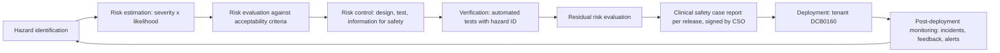

# Clinical risk management plan

| Item | Value |
| --- | --- |
| Product | Harbour (web, iOS and Android apps, API, sync service, optional AI module) |
| Manufacturer | Thapsus Cargo Ltd (trading as Thapsus) |
| Standard | [DCB0129: Clinical risk management: its application in the manufacture of health IT systems](https://adultsocialcare.standards.nhs.uk/published-standards/clinical-risk-management-its-application-in-the-manufacture-of-health-it-systems) |
| Document status | Draft v0.1, written in Phase 0. Not yet approved |
| Approval | Clinical Safety Officer `[CSO name - human action]` and top management `[Brian, Thapsus director - human action]` |
| Next scheduled review | Before the Phase 1 safety case (v0.1) is issued, then at least every 12 months |

This plan describes how Thapsus identifies, assesses, controls and monitors clinical risk in Harbour across its whole life, from design through decommissioning. It is the entry point to the clinical risk management file. The other documents in the file are:

| Artefact | Location |
| --- | --- |
| Hazard log | [hazard-log.md](hazard-log.md) |
| Clinical safety case reports, one per release | [safety-case/](safety-case/README.md) |
| DCB0160 deployment template for tenants | [dcb0160-deployment-template.md](dcb0160-deployment-template.md) |
| Medical-device boundary statement | [../compliance/medical-device-boundary.md](../compliance/medical-device-boundary.md) |
| Feature register (traceability from feature to spec, code and tests) | [../specs/feature-register.md](../specs/feature-register.md) |
| Outstanding human actions (signatures, appointments) | [../plans/human-actions.md](../plans/human-actions.md) |

National guidance on how the two standards fit together: [NHS England digital clinical safety assurance](https://www.england.nhs.uk/long-read/digital-clinical-safety-assurance/).

## 1. Scope

### 1.1 In scope

- Every Harbour component that stores, displays, transmits or acts on information about a person receiving care: the Next.js web app (management UI and portals), the Expo mobile app (Care, Manage, Family and Kiosk configurations), the Hono API and its background jobs, the PowerSync sync service and sync stream definitions, the notification centre, the forms and assessment engine, data import and export, the operator console, and the optional AI module.
- All Harbour releases, including EAS Update (over-the-air JavaScript) releases of the mobile app.
- Configuration options that Thapsus ships and tenants set (for example, auto-lock timers, witness rules for controlled drugs, alert thresholds), because a configurable default is a design decision.
- Data migration tooling, because an import that mis-maps an allergy or a dose is a clinical hazard.
- Decommissioning: tenant export and deletion at contract end.

### 1.2 Out of scope (covered by the tenant's DCB0160 work)

- How a provider deploys, configures, trains and uses Harbour in its own services. The tenant's own Clinical Safety Officer assesses this using [dcb0160-deployment-template.md](dcb0160-deployment-template.md).
- The provider's devices, networks, MDM configuration and local working practices.
- Third-party clinical systems Harbour connects to (GP Connect, pharmacy systems). Harbour's adapters to them are in scope; the remote systems are not.

### 1.3 Intended use

Harbour is a digital social care record and operational platform for regulated UK adult social care providers. It stores, displays and transmits care information, applies rules that the tenant configures, and calculates published validated tools (NEWS2, MUST, Waterlow and others) exactly as published. It does not diagnose, predict, score risk with its own algorithms or recommend treatment. The boundary is set out in [../compliance/medical-device-boundary.md](../compliance/medical-device-boundary.md); any change that would cross it is a hazard-log event and needs an ADR.

## 2. Roles and responsibilities

| Role | Holder | Responsibilities |
| --- | --- | --- |
| Top management | `[Brian, Thapsus director - human action]` | Accountable for clinical safety of the product. Approves this plan, provides resources, appoints the CSO, ensures no release goes to a live tenant without a CSO-signed safety case. |
| Clinical Safety Officer (CSO) | `[CSO name - human action]`, `[professional body and registration number - human action]` | A clinician holding current registration with a UK professional regulator (for example NMC, GMC or HCPC), trained and experienced in clinical risk management, as DCB0129 requires. To be appointed (contracted part-time is normal; see master prompt Appendix). Approves hazard assessments and risk acceptability, reviews every PR labelled `clinical` (asynchronously during the autonomous build, synchronously before a live tenant), signs each clinical safety case report, chairs hazard workshops, owns this plan. |
| Deputy CSO (optional) | `[name - human action]` | Covers absence. Must meet the same registration and training requirements. |
| Engineering lead | `[name - human action]` | Ensures every clinical change follows this plan: PR labelling, hazard-log updates in the same PR, verification tests named with hazard IDs, safety case delta per release. |
| Engineers (human and Claude Code) | All contributors | Raise hazards, label PRs `clinical` when they touch clinical functionality, write the verification tests, update the hazard log. The `clinical-safety-reviewer` agent reviews labelled PRs; it supports but never replaces the CSO. |
| Data Protection Officer or named lead | `[DPO or named lead - human action]` (master prompt default: Brian as named lead) | Consulted where a hazard has a confidentiality dimension (for example HZ-011). |
| Support and on-call | Thapsus support | Log tenant-reported safety issues and route them to the CSO within one working day; follow [../runbooks/incident-response.md](../runbooks/incident-response.md). |
| Tenant CSO (deployer) | Named by each tenant | Owns the tenant's DCB0160 assessment and reports safety issues back to Thapsus. |

### 2.1 Competence

The CSO's registration, clinical risk management training certificate and CV are held in the clinical risk management file `[CSO competence evidence - human action]`. Engineers receive a short induction on this plan and on the hazard log; completion is recorded in the onboarding checklist.

## 3. Clinical risk management process

### 3.1 Hazard identification method

Hazards are identified by several complementary methods so that no single technique is relied on:

| Method | When | Output |
| --- | --- | --- |
| Structured what-if technique (SWIFT) workshop led by the CSO, using guide words (wrong person, wrong time, wrong dose, missing, stale, duplicated, unavailable, misread, misconfigured, overloaded) against each workflow step | At the start of each module spec (before code), and whenever a workflow changes | New or updated hazard entries |
| Specification review against the regulator and clinical guidance named in the module's "Driver" column (for example NICE SC1, CQC time-sensitive medicines, RCP NEWS2) | Each module spec | Hazards and controls traced to the guidance |
| Human factors review of screens: identification, legibility, alert design, interruption, one-handed use, low light, low connectivity | Each UI feature, using Storybook and the design-partner home | Hazards relating to use error |
| Failure analysis of technical components (sync, clocks, time zones, auth, tenancy, notifications, imports) | Architecture changes and ADRs | Hazards such as HZ-006, HZ-009, HZ-010, HZ-011 |
| PR review: every PR labelled `clinical` answers "does this create, change or remove a hazard?" in the PR template | Every clinical PR | Hazard-log update in the same PR |
| Post-deployment sources: tenant incident reports, support tickets tagged `safety`, MHRA and NHS safety alerts, CQC guidance changes, published incidents involving comparable systems | Continuous; reviewed monthly by the CSO | New hazards or changed likelihood |

### 3.2 Risk estimation

Each hazard is assessed for the worst credible consequence (severity) and the likelihood of that consequence occurring. Thapsus adopts the five-by-five matrix and category definitions used in the DCB0129 guidance unchanged, so that tenants' DCB0160 assessments use the same scale.

**Severity (consequence) categories**

| Severity | Interpretation | Number of people affected |
| --- | --- | --- |
| Catastrophic | Death. Permanent life-changing incapacity, or any condition for which the prognosis is death or permanent life-changing incapacity. Severe injury or severe incapacity from which recovery is not expected in the short term | Multiple |
| Major | Death. Permanent life-changing incapacity, or any condition for which the prognosis is death or permanent life-changing incapacity. Severe injury or severe incapacity from which recovery is not expected in the short term | Single |
| Major | Severe injury or severe incapacity from which recovery is expected in the short term. Severe psychological trauma | Multiple |
| Considerable | Severe injury or severe incapacity from which recovery is expected in the short term. Severe psychological trauma | Single |
| Considerable | Minor injury or injuries from which recovery is not expected in the short term. Significant psychological trauma | Multiple |
| Significant | Minor injury or injuries from which recovery is not expected in the short term. Significant psychological trauma | Single |
| Significant | Minor injury from which recovery is expected in the short term. Minor psychological upset; inconvenience | Multiple |
| Minor | Minor injury from which recovery is expected in the short term. Minor psychological upset; inconvenience; any negligible severity of injury | Single |

**Likelihood categories**

| Likelihood | Interpretation |
| --- | --- |
| Very high | Certain or almost certain; highly likely to occur |
| High | Not certain but very possible; reasonably expected to occur in the majority of cases |
| Medium | Possible |
| Low | Could occur but in the great majority of occasions will not |
| Very low | Negligible or nearly impossible |

**Risk matrix** (resulting clinical risk level, 1 lowest to 5 highest)

| Likelihood \ Severity | Minor | Significant | Considerable | Major | Catastrophic |
| --- | --- | --- | --- | --- | --- |
| **Very high** | 3 | 4 | 4 | 5 | 5 |
| **High** | 2 | 3 | 3 | 4 | 5 |
| **Medium** | 2 | 2 | 3 | 3 | 4 |
| **Low** | 1 | 2 | 2 | 3 | 4 |
| **Very low** | 1 | 1 | 2 | 2 | 3 |

### 3.3 Risk evaluation and acceptability

| Risk level | Meaning | Action required by Thapsus |
| --- | --- | --- |
| 5 | Unacceptable level of risk | The feature does not ship. Redesign or remove. |
| 4 | Mandatory elimination of the hazard or addition of controls to reduce risk to an acceptable level | Controls must be added and verified before release. |
| 3 | Undesirable level of risk | Attempts must be made to eliminate the hazard or reduce the risk. Acceptable only when further reduction is impractical; the CSO records the justification in the hazard entry and the safety case. |
| 2 | Acceptable where the cost of further reduction outweighs the benefit, or further reduction is impractical | Monitor; review at the next scheduled review. |
| 1 | Acceptable, no further action required | Monitor. |

Residual risk at level 4 or 5 blocks a production release. Residual risk at level 3 needs explicit CSO acceptance in the safety case report (`[CSO acceptance - human action]` per release).

### 3.4 Risk control

Controls are chosen in this order of preference, and each hazard entry lists them under these headings:

1. **Design**: remove the hazard or make the unsafe action impossible (for example, the app refuses to record an administration without a selected person, a dose and an outcome, as master prompt section 10.3 requires).
2. **Test**: automated verification that the design control works and keeps working. Every hazard has at least one test whose name contains the hazard ID (for example `hazard HZ-004 blocks duplicate administration within the minimum interval`), so `grep -r "HZ-004"` across the repository finds its evidence. The Phase 1 gate requires every hazard-log entry to have a test.
3. **Training and user documentation (information for safety)**: in-app guidance, release notes, the role user guides and the DCB0160 pack. This is the weakest control and is never relied on alone for a level 4 or 5 initial risk.

New hazards introduced by a control (for example, alert fatigue introduced by a new warning, HZ-008) are assessed in the same way.

## 4. Hazard log management

- The hazard log lives in the repository at [hazard-log.md](hazard-log.md) so that it is versioned with the code, reviewed in PRs and routed by CODEOWNERS to a required reviewer.
- Hazard IDs are `HZ-NNN`, allocated sequentially and never reused or renumbered; code and tests reference them. A closed or withdrawn hazard stays in the log with its history.
- Status values: `open` (identified, controls not all verified), `controlled` (all controls implemented and verified, residual risk accepted by the CSO), `closed` (hazard no longer credible, for example the feature was removed; CSO approval required), `transferred` (residual risk passed to the deployer through the DCB0160 pack, with CSO agreement).
- Only the CSO may set `controlled`, `closed` or `transferred`. Engineers may add hazards and controls and propose ratings.
- An export in the format the NHS DSCR assurance process requests is generated from the Markdown log in Phase 5 (master prompt section 19).

## 5. Review triggers

The hazard log and, where relevant, the safety case are reviewed when any of the following happens:

| Trigger | Who | Evidence |
| --- | --- | --- |
| Every PR labelled `clinical` | Author, `clinical-safety-reviewer` agent, CSO | PR template "Clinical-safety impact: none / hazard IDs touched" answered; hazard log or spec updated in the same PR (the CI docs gate fails a `clinical` PR that leaves them untouched); medical-device boundary question answered |
| A new module or feature that a care worker, nurse or manager uses to make care decisions | CSO-led SWIFT workshop | Workshop notes linked from the hazard entries |
| A change to a validated assessment tool, a medicines rule, a time or interval calculation, sync, tenancy or authentication | Engineering lead and CSO | ADR where architecture changes; hazard entry updated |
| A change in law, regulator guidance or a published tool version (for example a new NEWS2 edition) | CSO | Hazard entry and spec updated |
| A safety incident or near miss reported by a tenant, a support ticket tagged `safety`, or a production incident with clinical impact | CSO within one working day of report | Incident record linked; likelihood re-rated |
| An MHRA or NHS safety alert relevant to digital records or medicines | CSO | Assessment note |
| Every release candidate | CSO | Clinical safety case report for that release ([safety-case/README.md](safety-case/README.md)) |
| Scheduled review | CSO and engineering lead | At least quarterly during the build; at least every 12 months after go-live |

## 6. Clinical safety case per release

- Every platform release `vMAJOR.MINOR.PATCH` has a clinical safety case report in [safety-case/](safety-case/README.md), named `safety-case-vX.Y-<label>.md`. Patch and EAS Update releases add a dated delta section to the current minor version's report rather than a new file, unless they change a hazard rating.
- The report states the claim (the release is acceptably safe for its intended use when deployed as described), the argument and the evidence (hazard log state, test results, outstanding issues), and lists every hazard opened, changed or closed since the previous release.
- The CSO signs the report `[CSO signature - human action]`. The autonomous build may tag and deploy to `dev` and `staging` with a draft (unsigned) report; no release is enabled for a live tenant until the report for that version is signed. Brian's production approval (master prompt section 7) checks for the signature.

## 7. DCB0160 hand-off to tenants

Each tenant is the deploying organisation and needs its own clinical risk management under DCB0160. Thapsus supplies, for every release a tenant runs:

- the signed clinical safety case report and the hazard log extract for the modules the tenant has enabled;
- the [DCB0160 deployment template](dcb0160-deployment-template.md), pre-filled where Harbour knows the answer (enabled modules, service types, device mode, configured thresholds);
- the list of hazards whose residual risk depends on deployer controls (for example MDM enrolment for kiosk devices, staff training, local escalation policy), marked "deployer control" in the hazard log;
- release notes in plain English with a "clinical safety changes" section;
- a route to report safety issues back to Thapsus (in-app support with the `safety` category, answered by the CSO).

Tenant onboarding ([../runbooks/tenant-onboarding.md](../runbooks/tenant-onboarding.md)) does not mark a tenant live until the tenant's CSO or named clinical lead has recorded completion of their DCB0160 assessment.

## 8. Post-deployment monitoring

- Safety issues reported by tenants are triaged by the CSO; any issue with potential for harm is handled as an incident ([../runbooks/incident-response.md](../runbooks/incident-response.md)) and, if needed, a field safety notice is sent to affected tenants in-app and by email within the time the CSO sets.
- Operational signals with clinical meaning are monitored: devices with upload queues older than the stale threshold (HZ-006), clock drift flags (HZ-010), duplicate-administration overrides (HZ-004), alert acknowledgement rates (HZ-008), notification clocks breached (HZ-013).
- Monthly summary to the CSO from Phase 1 onwards; quarterly report to top management.

## 9. Configuration management and document control

- This plan, the hazard log and the safety case reports are Markdown in Git. Changes go through PRs with signed commits; CODEOWNERS makes `docs/clinical-safety` a required-review path.
- The version history in Git is the document history. Signed safety case reports are additionally exported to PDF and the signature is recorded in the report itself and in [../plans/human-actions.md](../plans/human-actions.md).

## 10. Human actions

| Action | Owner |
| --- | --- |
| Appoint a Clinical Safety Officer (registered clinician, trained in clinical risk management) and record name, registration and training evidence | Brian |
| Approve this plan (CSO and top management signatures) | CSO, Brian |
| Run the first SWIFT workshop for the Phase 1 modules before the Phase 1 safety case v0.1 | CSO |
| Accept or reject the initial ratings and target residual ratings in the hazard log | CSO |
