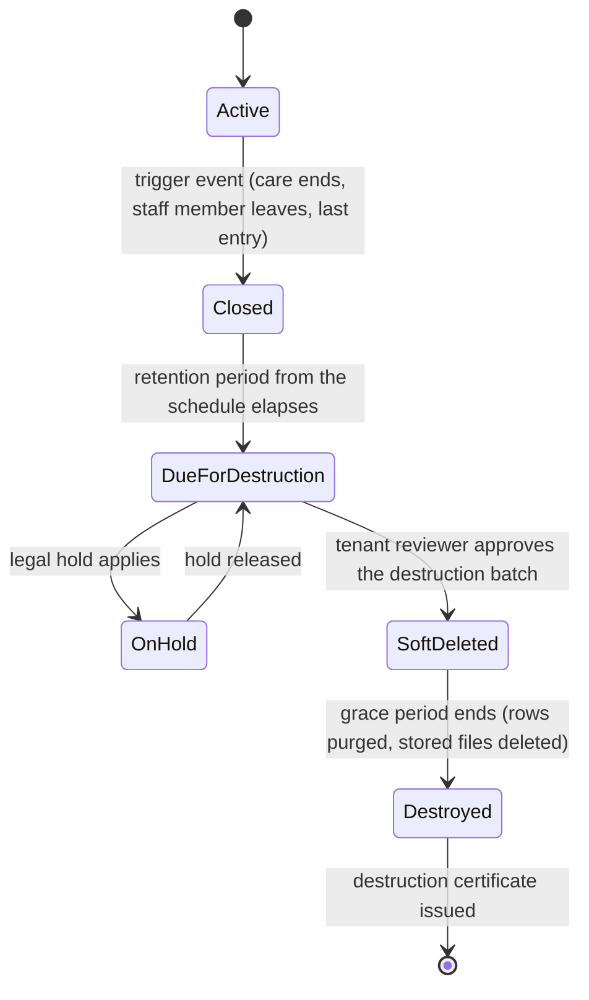

# Retention and deletion

| Item | Value |
| --- | --- |
| Law and guidance | UK GDPR Art 5(1)(e) (storage limitation) and Art 17 (erasure); [NHS Records Management Code of Practice](https://transform.england.nhs.uk/information-governance/guidance/records-management-code/records-management-code-of-practice/); [CQC: medicines administration records](https://www.cqc.org.uk/guidance-providers/adult-social-care/medicines-administration-records-adult-social-care) |
| Source requirement | Master prompt 5.1 (retention engine), 9.1 (retention and legal hold), 18 (`deleted_at` on every table) |
| The schedule | **[docs/specs/retention.md](../specs/retention.md)** holds the per-record-type retention periods, triggers and sources. This document describes the mechanism only |
| Status | Partly built (PLAT-012). Built: the schedule, legal holds on a resident or one record, destruction of documents on request with a signed certificate, and the whole-organisation shred. Also built: a nightly report of how many records each class has due, held and kept (off until the organisation turns it on; counts only, destroys nothing), and, in propose mode, destruction batches that propose records due for a person to review or cancel (proposals only: nothing is hidden or destroyed). Not built: approving a batch, any destruction of database rows when a class ends, the grace period, and holds wider than a resident or one record. [The retention sweeps plan](../plans/retention-sweeps.md) sets out how the rest is built, in slices, report only first; [ADR-0135](../decisions/0135-retention-row-destruction.md) (proposed) records the design |

## 1. Lifecycle of a record

**Today** only documents follow this lifecycle, and only in part: `GET /v1/retention/candidates` lists
documents past their period with no hold, and a reviewer with `platform.retention.manage` and step-up
destroys the ones they pick (`POST /v1/retention/destroy`). There is no nightly list, no batch and no
grace period: the document becomes a tombstone at once and every stored version is deleted, with a
signed certificate per class. Only documents whose class counts from `care_ended` or `created` are
offered. Nothing destroys database rows when their class ends. The diagram and table below are the
target, built by the [retention sweeps plan](../plans/retention-sweeps.md).

| Stage | What happens |
| --- | --- |
| Active | Record in use. Its **retention class** (from the schedule) is set when the record type is defined. Most tables carry `deleted_at`, but 64 Phase 2 tables with personal data do not, and on others it has feature meanings, so retention's soft delete uses its own column (ADR-0135, proposed) |
| Closed | A trigger event starts the retention clock, for example care ending for care records (default 8 years after care ends) or the last entry for a controlled drugs register (2 years). The schedule names the trigger for each class |
| Due for destruction | A nightly job lists records whose period has elapsed and puts them in a destruction batch for the tenant to review. Nothing is destroyed without review. Records of a `tenant_policy` class are never offered until the organisation sets a period (provisional, H-1585) |
| On hold | A legal hold blocks destruction (see section 3) |
| Soft deleted | Two different people approve the batch: a reviewer holding `platform.retention.manage` with step-up authentication, and a second person (provisional, H-1581). A retention-only column (`retention_deleted_at`, ADR-0135, proposed) is set; records disappear from every user interface, search, sync stream and export, but Thapsus support can restore the batch on the organisation's written request during a grace period of 30 days (rate table `retention.grace_days`; provisional, H-1556) |
| Destroyed | The rows are deleted, or, for rota, pay runs, audits and outbreak line lists, their personal columns are cleared and the anonymous row kept (provisional, H-1560); their `record_version` copies are deleted; every version of linked stored files is deleted (section 4). Database rows are not field-encrypted, so no key is destroyed: copies in point-in-time recovery expire after 7 or 35 days, which the certificate states (ADR-0109; provisional, H-1582). A destroyed document keeps a tombstone row with only the opaque ID, class, dates and certificate reference |

## 2. Rules

- Tenants may lengthen a period or choose between options the Code allows (for example staff files: 6 years after leaving or to the 75th birthday), but cannot set a period below a statutory or Code minimum in the schedule.
- Append-only event tables (care notes, observations, administrations, controlled-drug entries, audit events) have no UPDATE or DELETE grant for the application role, and a trigger refuses UPDATE and DELETE on them for every role; many mutable tables refuse DELETE the same way. No role may destroy their rows today: the only exception is removing sample data (`harbour_sample_owner`). The plan adds one NOLOGIN role, `harbour_retention_owner`, with a fixed table list and one exception in that trigger (ADR-0135, proposed; plan slice 7).
- Erasure requests under Art 17 are honoured only where no retention obligation applies; otherwise the request is refused with the reason recorded and given to the requester ([dsar-procedure.md](dsar-procedure.md)).
- Audit events about a record are kept at least as long as the record (retention.md, `audit_event.care_record`) and for their own class (8 years from creation), as opaque ids; they are not destroyed with the record. The free-text `reason` on them is cleared when the record is destroyed (provisional, H-1559; plan slice 14). Nothing deletes audit events today.
- Security logs are kept at least 6 months (master prompt 5.3) and then deleted on a fixed schedule.
- The production audit archive is a Cloud Storage bucket with a **locked** retention policy of 365 days ([ADR-0098](../decisions/0098-production-on-google-cloud.md), [H-55](../plans/human-actions.md)), which replaces S3 Object Lock in compliance mode: no archived object can be deleted or replaced before it is 365 days old, and a locked policy cannot be shortened or removed.

## 3. Legal holds

| Item | Detail |
| --- | --- |
| Who can place one | A member holding `platform.retention.manage` (`POST /v1/legal-holds`); Thapsus only on the tenant's instruction |
| Scope today | A resident (`person_id`: every record about them) or one record (`subject_type` and `subject_id`). A hold covers every version of a document, its person and the record it belongs to |
| Scope planned | A member of staff, an applicant, a record class, a location and a date range (plan slice 12). An open DSAR case, complaint, safeguarding enquiry or employee relations case is to hold its subject's records automatically while it is open (provisional, H-1586); until then a hold is placed by hand |
| Record | Reason, who placed it and when; release with who, when and a reason. No reference or review date is stored yet |
| Effect | Records in scope are never offered for destruction, checked again under the organisation's retention lock when destroying; sync and access are unchanged |
| Review | Placing and releasing a hold are audited (`platform.legal_hold.place`, `platform.legal_hold.release`). There is no review date or reminder yet |

## 4. Cryptographic shredding

Deleting rows from the live database does not remove copies from backups (Cloud SQL automated backups and point-in-time recovery, kept for the retention period set in the Google Cloud Terraform, [ADR-0098](../decisions/0098-production-on-google-cloud.md)) or from object storage versions. [ADR-0109](../decisions/0109-per-organisation-crypto-shredding.md) decided how each is handled: stored files are envelope-encrypted under the organisation's key and deleted version by version; database rows are deleted and leave backups when point-in-time recovery expires; destroying the key itself is the whole-organisation path only.

| Element | Design |
| --- | --- |
| Envelope encryption | Stored objects (documents, export archives, DSAR bundles) are encrypted before they reach object storage, each with its own 256-bit data key wrapped by the organisation's own key: one Cloud KMS key per organisation in europe-west2, rotated every 90 days, with the bucket's CMEK as a second layer ([ADR-0109](../decisions/0109-per-organisation-crypto-shredding.md)). Database rows are not field-encrypted: they are soft deleted, then purged with a certificate that records when point-in-time recovery no longer holds them (ADR-0109, "Database rows"). Per-person data keys are not used |
| Destroying a subset | Today, documents only: a reviewer picks documents past their period (`POST /v1/retention/destroy`); each becomes a tombstone and every version of its stored file is deleted, with a signed certificate per class. Destroying database rows by class (soft delete, grace period, then purge, with a certificate per batch, class and table) is planned ([retention sweeps plan](../plans/retention-sweeps.md) slices 9 and 10). Any copy left in a backup expires with the point-in-time recovery window, which meets the requirement for database rows (ADR-0109; provisional, H-1582) |
| Whole-tenant exit | At the end of a contract, after the tenant's free export, one member requests, naming the downloaded export, and a different member approves within 7 days (both with step-up, never under a legal hold) the shred of the organisation's key: every key version is scheduled for destruction (30 days in Cloud KMS), reads fail at once, and a signed certificate records the key versions and their destroy times ([platform.md](../specs/platform.md#crypto-shredding-plat-012-adr-0109); [DPA clause 9](dpa-article-28-template.md#9-deletion-or-return-at-the-end-of-the-services-art-283g)) |
| Mobile devices | Records leave devices through sync (eviction) and on remote wipe; device stores are SQLCipher-encrypted with device-bound keys |
| Restore safety | A restore from backup re-applies the shredding log before the database is reopened, so shredded records cannot reappear ([restore runbook](../runbooks/restore.md)) |
| Status | Built (PLAT-012): per-organisation keys, envelope encryption of stored files, document destruction on request and the whole-organisation shred. Not built: destruction of database rows when a class ends, and DSAR bundles destroyed with their case ([retention sweeps plan](../plans/retention-sweeps.md)) |
| Search vectors | The generated `tsvector` search columns (ADR-0070, migration 0066) are plain-text copies of names, rooms, document titles and note text. Purging the row removes them, and they leave backups as the row does. No column is envelope-encrypted (ADR-0109), so the search vectors question (H-380) does not arise |

## 5. Destruction certificate

Each destruction produces a certificate (today one per class for each document destruction, and one for a whole-organisation shred), kept permanently as a signed record in the database (it contains no personal data: members by opaque id). The PDF is built from that record when someone downloads it, never stored: after a whole-organisation shred the tenant's document store no longer opens, so a stored copy would be unreadable ([platform.md](../specs/platform.md#crypto-shredding-screens-and-certificates-plat-012-part-2) rule 12; H-1220).

| Field | Content |
| --- | --- |
| Certificate ID and date | Unique ID; UTC timestamp |
| Tenant | Legal name and ID |
| Records | Retention class, subject type, record count, opaque record IDs. A batch reference is added when destruction batches are built (plan slice 10) |
| Rule applied | Schedule entry and version from [../specs/retention.md](../specs/retention.md), trigger date, period |
| Holds check | Confirmation that no legal hold applied at destruction time |
| Approval | The requester and approver as opaque member references (names on the screens only; ADR-0109); both confirmed it was them by step-up (H-1221) |
| Method | Object version deletion for documents; for a whole-organisation shred, key destruction (key and key version IDs, the Cloud KMS scheduled-destruction delay and the date each version is destroyed); row purge or column clearing once row destruction is built; the backup expiry date after which no copy remains (`backups_expire_at`) |
| Integrity | Signed by the Thapsus Care signing key (Cloud KMS EC P-256, or a local Ed25519 key); a verification route checks it |

## 6. Phase plan

| Capability | Phase |
| --- | --- |
| `deleted_at` on every table | Phase 0 data model (master prompt 18) |
| Retention class per record type, legal holds on a resident or one record, document destruction and certificates, whole-organisation shred | Built in Phase 1 (PLAT-012) |
| Envelope encryption of stored files under per-organisation keys; database columns not field-encrypted | Built ([ADR-0109](../decisions/0109-per-organisation-crypto-shredding.md)) |
| Row destruction when a class ends: report, destruction batches, soft delete, grace period, purge, wider legal holds | Phase 2, [retention sweeps plan](../plans/retention-sweeps.md) slices 1 to 14 |
