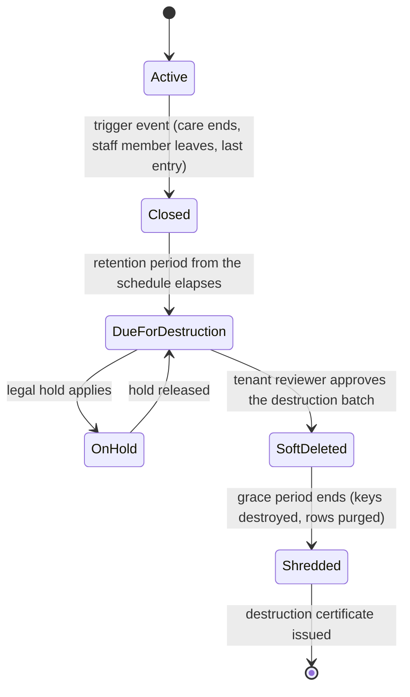

# Retention and deletion

| Item | Value |
| --- | --- |
| Law and guidance | UK GDPR Art 5(1)(e) (storage limitation) and Art 17 (erasure); [NHS Records Management Code of Practice](https://transform.england.nhs.uk/information-governance/guidance/records-management-code/records-management-code-of-practice/); [CQC: medicines administration records](https://www.cqc.org.uk/guidance-providers/adult-social-care/medicines-administration-records-adult-social-care) |
| Source requirement | Master prompt 5.1 (retention engine), 9.1 (retention and legal hold), 18 (`deleted_at` on every table) |
| The schedule | **[docs/specs/retention.md](../specs/retention.md)** holds the per-record-type retention periods, triggers and sources. This document describes the mechanism only |
| Status | Design, Phase 0. Implementation phase per [docs/specs/feature-register.md](../specs/feature-register.md) |

## 1. Lifecycle of a record

| Stage | What happens |
| --- | --- |
| Active | Record in use. Its **retention class** (from the schedule) is set when the record type is defined; every table carries `deleted_at` |
| Closed | A trigger event starts the retention clock, for example care ending for care records (default 8 years after care ends) or the last entry for a controlled drugs register (2 years). The schedule names the trigger for each class |
| Due for destruction | A nightly job lists records whose period has elapsed and puts them in a destruction batch for the tenant to review. Nothing is destroyed without review |
| On hold | A legal hold blocks destruction (see section 3) |
| Soft deleted | The tenant's reviewer (Owner role or data protection lead) approves the batch with step-up authentication. `deleted_at` is set; records disappear from every user interface, search, sync stream and export, but remain recoverable by Thapsus support on the tenant's request during a grace period of `[30]` days `[confirm - human action]` |
| Shredded | Encryption keys for the batch are destroyed and the rows and objects are purged (section 4). A tombstone row keeps only the opaque ID, retention class, dates and certificate reference, with no personal data |

## 2. Rules

- Tenants may lengthen a period or choose between options the Code allows (for example staff files: 6 years after leaving or to the 75th birthday), but cannot set a period below a statutory or Code minimum in the schedule.
- Append-only event tables (care notes, observations, administrations, controlled-drug entries, audit events) have no UPDATE or DELETE grant for the application role. Destruction runs as a separate, audited maintenance role used only by the retention job.
- Erasure requests under Art 17 are honoured only where no retention obligation applies; otherwise the request is refused with the reason recorded and given to the requester ([dsar-procedure.md](dsar-procedure.md)).
- Audit events about a record are kept as long as the record, then shredded with it, except the destruction event itself.
- Security logs are kept at least 6 months (master prompt 5.3) and then deleted on a fixed schedule.

## 3. Legal holds

| Item | Detail |
| --- | --- |
| Who can place one | Owner, Registered Manager or data protection lead; Thapsus only on the tenant's instruction |
| Scope | A person, a staff member, a location, a record type, a date range, or a named case (for example an inquest, litigation, safeguarding enquiry, CQC investigation, police request) |
| Record | Reason, reference, who placed it, date, review date |
| Effect | Records in scope are excluded from destruction batches; sync and access are unchanged |
| Review | Holds have a review date; a reminder goes to the person who placed it; release is audited |

## 4. Cryptographic shredding

Deleting rows from the live database does not remove copies from backups (point-in-time recovery and snapshots are kept for 35 days) or from object storage versions. Cryptographic shredding makes those copies unreadable.

| Element | Design |
| --- | --- |
| Envelope encryption | Content columns that hold free text and documents, and S3 objects, are encrypted with a data encryption key (DEK) per person (or per staff member for workforce records). DEKs are wrapped by a per-tenant key in AWS KMS |
| Shredding | Destroy the DEKs for the batch, then purge the rows and delete all S3 object versions. Any copy left in a backup or replica is ciphertext without a key |
| Whole-tenant exit | At the end of a contract, after the tenant's free export, the tenant KMS key is scheduled for deletion (minimum KMS waiting period applies) once live data is purged ([DPA clause 9](dpa-article-28-template.md#9-deletion-or-return-at-the-end-of-the-services-art-283g)) |
| Mobile devices | Records leave devices through sync (eviction) and on remote wipe; device stores are SQLCipher-encrypted with device-bound keys |
| Restore safety | A restore from backup re-applies the shredding log before the database is reopened, so shredded records cannot reappear ([restore runbook](../runbooks/restore.md)) |

| Search vectors | The generated `tsvector` search columns (ADR-0070, migration 0066) are plain-text copies of names, rooms, document titles and note text. Purging the row removes them, and they leave backups as the row does; but they are not encrypted, so if a source column (such as `care_note.body`) is envelope-encrypted, its vector must be dropped or redesigned in the same change, or the words outlive the key (H-380) |

Design decision to record in an ADR `[engineering]`: which columns are envelope-encrypted, and how search and reporting work over them.

## 5. Destruction certificate

Each shredded batch produces a certificate, stored as a signed PDF in the tenant's document store and kept permanently (it contains no personal data).

| Field | Content |
| --- | --- |
| Certificate ID and date | Unique ID; UTC timestamp |
| Tenant | Legal name and ID |
| Batch | Retention class, record count, opaque record IDs (hashed list attached) |
| Rule applied | Schedule entry and version from [../specs/retention.md](../specs/retention.md), trigger date, period |
| Holds check | Confirmation that no legal hold applied at destruction time |
| Approval | Reviewer name, role, step-up authentication time |
| Method | Key destruction (key IDs), row purge, object version deletion; backup expiry date after which no ciphertext remains |
| Integrity | SHA-256 of the certificate, signed by the Harbour signing key |

## 6. Phase plan

| Capability | Phase |
| --- | --- |
| `deleted_at` on every table | Phase 0 data model (master prompt 18) |
| Retention class per record type, retention engine, legal holds, destruction batches and certificates | Per [feature register](../specs/feature-register.md) |
| Envelope encryption for content columns and documents | ADR, then with the first module that stores free text (Phase 1) |
